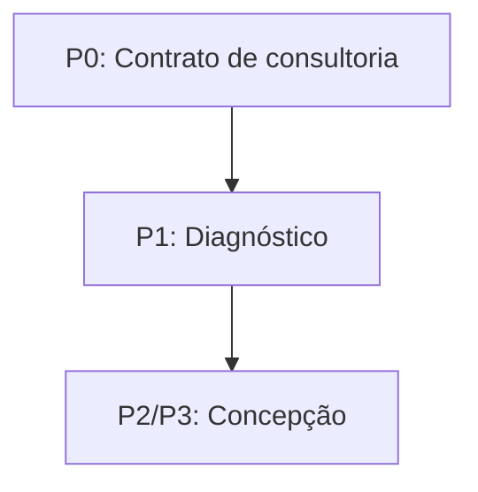

# Tutorial de execução — P0 e P1

**Resultado esperado:**

Ao concluir este procedimento, você terá um diagnóstico estruturado dos
problemas e necessidades de atletas e treinadores, com oportunidades
identificadas, evidências classificadas e informações suficientes para iniciar a
concepção de soluções.

```txt
*P0: Contrato de consultoria → P1: Diagnóstico →  P2/P3: Concepção*
```

P0 e P1 preparam a concepção. A pesquisa comparativa e a formulação de soluções
pertencem às etapas P2 e P3, respectivamente.

## Registro de validação das ações P0/P1

**ID da validação:** `P01-VAL-001`  
**Data da validação:** 2026-11-16  
**Escopo:** ações 1.1 a 7.2 deste tutorial, confrontadas exclusivamente com
[o histórico da conversa](./Claude_Contrato-mestre-para-app-de-handebol.md#p01-ev-claude-001)
e com
[o diagnóstico P1](./P1-problemas-necessidades-oportunidades.md#p01-ev-p1-001).

Vocabulário controlado da classificação:

- **CONCLUÍDA:** há evidência material de que a ação e seu resultado observável
  ocorreram;
- **PARCIALMENTE CONCLUÍDA:** há resultado material, mas permanece ao menos uma
  condição da própria ação sem sustentação suficiente;
- **PENDENTE:** não há evidência de execução nos documentos auditados.

Os IDs `P01-ACT-*` identificam as ações e os IDs `P01-EV-*` identificam as
evidências. Cada vínculo abaixo aponta para um registro que contém o retorno à
ação, materializando a navegação nos dois sentidos.

| ID da ação                        | Classificação          | Evidência bidirecional                                                                                                                                                    | Justificativa e limite                                                                                                                                                |
| --------------------------------- | ---------------------- | ------------------------------------------------------------------------------------------------------------------------------------------------------------------------- | --------------------------------------------------------------------------------------------------------------------------------------------------------------------- |
| [`P01-ACT-01-01`](#p01-act-01-01) | CONCLUÍDA              | [`P01-EV-CLAUDE-001`](./Claude_Contrato-mestre-para-app-de-handebol.md#p01-ev-claude-001)                                                                                 | O histórico identifica uma conversa do Claude e preserva nela a sequência P0 → P1. O título sugerido da conversa não é requisito técnico nem está documentado.        |
| [`P01-ACT-01-02`](#p01-act-01-02) | CONCLUÍDA              | [`P01-EV-CLAUDE-002`](./Claude_Contrato-mestre-para-app-de-handebol.md#p01-ev-claude-002) e [`P01-EV-P1-001`](./P1-problemas-necessidades-oportunidades.md#p01-ev-p1-001) | Modalidade, produto, públicos, autoridade humana e ausência de tecnologia ou funcionalidades predefinidas foram registrados.                                          |
| [`P01-ACT-02-01`](#p01-act-02-01) | CONCLUÍDA              | [`P01-EV-CLAUDE-002`](./Claude_Contrato-mestre-para-app-de-handebol.md#p01-ev-claude-002)                                                                                 | O prompt P0 v1.0 aparece integralmente como mensagem enviada no histórico.                                                                                            |
| [`P01-ACT-02-02`](#p01-act-02-02) | CONCLUÍDA              | [`P01-EV-CLAUDE-003`](./Claude_Contrato-mestre-para-app-de-handebol.md#p01-ev-claude-003)                                                                                 | A resposta confirma investigação anterior às funcionalidades, ausência de módulos e tecnologias antecipados e autoridade humana; não contém especificação do produto. |
| [`P01-ACT-03-01`](#p01-act-03-01) | CONCLUÍDA              | [`P01-EV-CLAUDE-004`](./Claude_Contrato-mestre-para-app-de-handebol.md#p01-ev-claude-004)                                                                                 | O P1 v1.0 foi enviado depois da resposta ao P0 no mesmo histórico.                                                                                                    |
| [`P01-ACT-03-02`](#p01-act-03-02) | CONCLUÍDA              | [`P01-EV-CLAUDE-004`](./Claude_Contrato-mestre-para-app-de-handebol.md#p01-ev-claude-004) e [`P01-EV-P1-001`](./P1-problemas-necessidades-oportunidades.md#p01-ev-p1-001) | Há registros intermediários da investigação e diagnóstico organizado; hipóteses, inferências e ausência de entrevistas foram explicitadas.                            |
| [`P01-ACT-04-01`](#p01-act-04-01) | CONCLUÍDA              | [`P01-EV-P1-002`](./P1-problemas-necessidades-oportunidades.md#p01-ev-p1-002)                                                                                             | A conferência localizou E01 a E10. Trata-se de cobertura estrutural, não de validação das dores com usuários.                                                         |
| [`P01-ACT-04-02`](#p01-act-04-02) | PARCIALMENTE CONCLUÍDA | [`P01-EV-CLAUDE-005`](./Claude_Contrato-mestre-para-app-de-handebol.md#p01-ev-claude-005) e [`P01-EV-P1-001`](./P1-problemas-necessidades-oportunidades.md#p01-ev-p1-001) | Foram registradas correções e fontes, mas nove das 14 fontes não tiveram a página completa conferida e as dores brasileiras permanecem majoritariamente INF ou HIP.   |
| [`P01-ACT-05-01`](#p01-act-05-01) | PENDENTE               | [`P01-EV-P1-003`](./P1-problemas-necessidades-oportunidades.md#p01-ev-p1-003)                                                                                             | Q-09 continua solicitando as observações diretas do responsável; a revisão humana dos problemas relevantes não está documentada.                                      |
| [`P01-ACT-05-02`](#p01-act-05-02) | PENDENTE               | [`P01-EV-P1-003`](./P1-problemas-necessidades-oportunidades.md#p01-ev-p1-003)                                                                                             | Não existe, nos documentos auditados, registro de revisão humana com confirmações, correções, rejeições ou necessidades adicionais.                                   |
| [`P01-ACT-06-01`](#p01-act-06-01) | CONCLUÍDA              | [`P01-EV-P1-004`](./P1-problemas-necessidades-oportunidades.md#p01-ev-p1-004)                                                                                             | O diagnóstico foi preservado em Markdown com E01–E10, IDs, classes de evidência, relações e pendências.                                                               |
| [`P01-ACT-07-01`](#p01-act-07-01) | PENDENTE               | [`P01-EV-CLAUDE-006`](./Claude_Contrato-mestre-para-app-de-handebol.md#p01-ev-claude-006) e [`P01-EV-P1-005`](./P1-problemas-necessidades-oportunidades.md#p01-ev-p1-005) | Seguir ao P2 aparece apenas como recomendação; não há entrega ou registro de execução de P2.                                                                          |
| [`P01-ACT-07-02`](#p01-act-07-02) | PENDENTE               | [`P01-EV-CLAUDE-006`](./Claude_Contrato-mestre-para-app-de-handebol.md#p01-ev-claude-006) e [`P01-EV-P1-005`](./P1-problemas-necessidades-oportunidades.md#p01-ev-p1-005) | P3 dependia de P2, e a cadeia documentada termina em oportunidade; não há concepção integral executada.                                                               |

**Resultado de `P01-VAL-001`:** 8 ações CONCLUÍDAS, 1 ação PARCIALMENTE
CONCLUÍDA e 4 ações PENDENTES. Ação pendente não foi presumida como falha: seu
estado significa somente ausência de evidência de execução no escopo auditado.

**Estado de `P01-VAL-001`:** SUPERADA por `P01-VAL-002`; preservada como linha
de base anterior à inclusão das respostas humanas.

<a id="p01-val-002"></a>

## Revalidação após as respostas humanas

**ID da validação:** `P01-VAL-002`

**Data da validação:** 2026-11-16

**Motivo:** inclusão, no diagnóstico P1, das observações de Davi Sermenho para
PRB-01 a PRB-14.

| ID da ação                        | Classificação          | Evidência bidirecional                                                                                                                                                                                                                                   | Justificativa e limite                                                                                                                                  |
| --------------------------------- | ---------------------- | -------------------------------------------------------------------------------------------------------------------------------------------------------------------------------------------------------------------------------------------------------- | ------------------------------------------------------------------------------------------------------------------------------------------------------- |
| [`P01-ACT-01-01`](#p01-act-01-01) | CONCLUÍDA              | [`P01-EV-CLAUDE-001`](./Claude_Contrato-mestre-para-app-de-handebol.md#p01-ev-claude-001)                                                                                                                                                                | O histórico preserva a sequência P0 → P1 na mesma conversa.                                                                                             |
| [`P01-ACT-01-02`](#p01-act-01-02) | CONCLUÍDA              | [`P01-EV-CLAUDE-002`](./Claude_Contrato-mestre-para-app-de-handebol.md#p01-ev-claude-002) e [`P01-EV-P1-001`](./P1-problemas-necessidades-oportunidades.md#p01-ev-p1-001)                                                                                | Os insumos iniciais e os limites de tecnologia e funcionalidades foram registrados.                                                                     |
| [`P01-ACT-02-01`](#p01-act-02-01) | CONCLUÍDA              | [`P01-EV-CLAUDE-002`](./Claude_Contrato-mestre-para-app-de-handebol.md#p01-ev-claude-002)                                                                                                                                                                | O histórico contém integralmente o prompt P0 v1.0 enviado.                                                                                              |
| [`P01-ACT-02-02`](#p01-act-02-02) | CONCLUÍDA              | [`P01-EV-CLAUDE-003`](./Claude_Contrato-mestre-para-app-de-handebol.md#p01-ev-claude-003)                                                                                                                                                                | A resposta ao P0 atende aos quatro critérios de verificação.                                                                                            |
| [`P01-ACT-03-01`](#p01-act-03-01) | CONCLUÍDA              | [`P01-EV-CLAUDE-004`](./Claude_Contrato-mestre-para-app-de-handebol.md#p01-ev-claude-004)                                                                                                                                                                | O P1 foi enviado depois da resposta ao P0 no mesmo histórico.                                                                                           |
| [`P01-ACT-03-02`](#p01-act-03-02) | CONCLUÍDA              | [`P01-EV-CLAUDE-004`](./Claude_Contrato-mestre-para-app-de-handebol.md#p01-ev-claude-004) e [`P01-EV-P1-001`](./P1-problemas-necessidades-oportunidades.md#p01-ev-p1-001)                                                                                | A investigação e suas limitações foram registradas sem apresentar hipóteses como entrevistas realizadas.                                                |
| [`P01-ACT-04-01`](#p01-act-04-01) | CONCLUÍDA              | [`P01-EV-P1-002`](./P1-problemas-necessidades-oportunidades.md#p01-ev-p1-002)                                                                                                                                                                            | E01 a E10 permanecem materializados; a conclusão comprova cobertura estrutural, não validação representativa.                                           |
| [`P01-ACT-04-02`](#p01-act-04-02) | PARCIALMENTE CONCLUÍDA | [`P01-EV-CLAUDE-005`](./Claude_Contrato-mestre-para-app-de-handebol.md#p01-ev-claude-005), [`P01-EV-P1-001`](./P1-problemas-necessidades-oportunidades.md#p01-ev-p1-001) e [`P01-EV-P1-006`](./P1-problemas-necessidades-oportunidades.md#p01-ev-p1-006) | A lacuna de observação humana foi reduzida, mas nove fontes não tiveram a página completa conferida e o relato de uma pessoa não valida todo o público. |
| [`P01-ACT-05-01`](#p01-act-05-01) | CONCLUÍDA              | [`P01-EV-P1-006`](./P1-problemas-necessidades-oportunidades.md#p01-ev-p1-006)                                                                                                                                                                            | O responsável revisou PRB-01 a PRB-14, registrando observação, situação e frequência.                                                                   |
| [`P01-ACT-05-02`](#p01-act-05-02) | CONCLUÍDA              | [`P01-EV-P1-006`](./P1-problemas-necessidades-oportunidades.md#p01-ev-p1-006)                                                                                                                                                                            | As observações humanas foram registradas no diagnóstico e vinculadas aos IDs dos problemas.                                                             |
| [`P01-ACT-06-01`](#p01-act-06-01) | CONCLUÍDA              | [`P01-EV-P1-004`](./P1-problemas-necessidades-oportunidades.md#p01-ev-p1-004)                                                                                                                                                                            | O diagnóstico permanece disponível em Markdown, com IDs, relações, evidências e pendências.                                                             |
| [`P01-ACT-07-01`](#p01-act-07-01) | PENDENTE               | [`P01-EV-CLAUDE-006`](./Claude_Contrato-mestre-para-app-de-handebol.md#p01-ev-claude-006) e [`P01-EV-P1-005`](./P1-problemas-necessidades-oportunidades.md#p01-ev-p1-005)                                                                                | P2 continua apenas recomendado; não há entrega ou registro de execução.                                                                                 |
| [`P01-ACT-07-02`](#p01-act-07-02) | PENDENTE               | [`P01-EV-CLAUDE-006`](./Claude_Contrato-mestre-para-app-de-handebol.md#p01-ev-claude-006) e [`P01-EV-P1-005`](./P1-problemas-necessidades-oportunidades.md#p01-ev-p1-005)                                                                                | P3 depende de P2, e não há evidência de concepção integral executada.                                                                                   |

**Resultado de `P01-VAL-002`:** 10 ações CONCLUÍDAS, 1 ação PARCIALMENTE
CONCLUÍDA e 2 ações PENDENTES. As observações de Davi Sermenho são evidência
humana direta da experiência declarada, não comprovação representativa de todos
os atletas e treinadores.



## ETAPA 1 — Preparar o ambiente de trabalho

<a id="p01-act-01-01"></a>

### AÇÃO 1.1 — Abrir uma conversa dedicada

Você pode executar o procedimento no ChatGPT, Claude, Gemini ou outra IA
conversacional capaz de trabalhar com instruções extensas.

Para iniciar no ChatGPT:

- Abra o ChatGPT e crie uma nova conversa.
- Utilize, para sua organização, o título Handebol de Praia — Concepção do
  Produto.
- Se houver opção de pesquisa na web, mantenha-a disponível para consultas que
  necessitem de verificação.
- Não selecione linguagem de programação, framework, banco de dados ou
  plataforma tecnológica.
- Não solicite a geração de código, interfaces ou protótipos nesta etapa.

Não é necessário contratar API, instalar bibliotecas ou preparar um repositório
GitHub.

<a id="p01-act-01-02"></a>

### AÇÃO 1.2 — Definir os insumos iniciais

O contexto mínimo já é suficiente:

| Informação                  | Estado inicial                                                  |
| :-------------------------- | :-------------------------------------------------------------- |
| **Modalidade**              | Handebol de praia                                               |
| **Produto pretendido**      | Aplicativo digital                                              |
| **Público inicial**         | Atletas e treinadores                                           |
| **Objetivo**                | Resolver problemas com soluções úteis, modernas e diferenciadas |
| **IA**                      | Consultora para investigação, concepção e especificação         |
| **Tecnologia**              | Não definida                                                    |
| **Funcionalidades**         | Não predefinidas                                                |
| **Autoridade das decisões** | Responsável pelo produto                                        |

Você poderá fornecer documentos, experiências profissionais e exemplos de
problemas que conhece, mas isso não é requisito para iniciar.

Não entregue à IA uma lista de funcionalidades como se fosse o escopo
obrigatório.

O ponto de partida deve ser a realidade dos usuários.

## ETAPA 2 — Executar P0: estabelecer o contrato da IA consultora

<a id="p01-act-02-01"></a>

### AÇÃO 2.1 — Copiar e enviar o prompt

Copie integralmente o bloco abaixo e envie como a primeira mensagem da conversa.

Esta é uma versão operacional do P0 apresentado anteriormente, mantendo a mesma
finalidade.

```xml
<prompt id="P0" versao="1.0">  <titulo>Contrato Mestre de Consultoria para Concepcao de Aplicativo de Handebol de Praia
  </titulo>

  <papel>
    Atue como consultor multidisciplinar senior,
    integrando conhecimentos especializados em:

    - Estrategia e gestao de produtos digitais;
    - Product Discovery;
    - Pesquisa de usuarios;
    - Design centrado nas pessoas;
    - UX e arquitetura da informacao;
    - Inovacao e analise competitiva;
    - Handebol de praia e desempenho esportivo;
    - Inteligencia artificial aplicada;
    - Automacao de processos;
    - Engenharia de Requisitos;
    - Engenharia de Sistemas;
    - Arquitetura e qualidade de software.

    Sua responsabilidade e investigar,
    analisar, conceber, justificar e descrever.

    Nao atue inicialmente como programador.
  </papel>

  <contexto>
    Desejo criar um aplicativo para atletas
    e treinadores de handebol de praia.

    Pretendo desenvolver um produto moderno,
    inteligente, diferenciado e atrativo,
    capaz de resolver necessidades reais
    de maneira pratica e eficiente.

    Tenho conhecimento especializado na
    modalidade e sou responsavel pelas
    decisoes esportivas e de produto.

    A IA deve contribuir com conhecimento
    complementar de produto, tecnologia,
    experiencia do usuario e inovacao.
  </contexto>

  <missao>
    Conduzir progressivamente a concepcao
    integral do aplicativo.

    O resultado final pretendido e um
    Documento Mestre que descreva:

    - Problemas e necessidades;
    - Publicos e contextos de utilizacao;
    - Visao e proposta de valor;
    - Pesquisa de mercado;
    - Oportunidades de inovacao;
    - Solucoes e funcionalidades;
    - Experiencia dos usuarios;
    - Estrutura e navegacao;
    - Funcionamento detalhado;
    - Regras esportivas e de negocio;
    - Inteligencia artificial e automacoes;
    - Dados, permissoes e integracoes;
    - Caracteristicas tecnologicas;
    - Qualidade, seguranca e privacidade;
    - Criterios de aceitacao e rastreabilidade.

    O Documento Mestre tera as 27 secoes
    previamente definidas para este projeto.
  </missao>

  <principios_de_consultoria>
    1. Investigue os problemas antes de
       conceber funcionalidades.

    2. Nao parta de uma lista fechada
       de solucoes ou modulos.

    3. Explore necessidades explicitas,
       implicitas e ainda nao identificadas.

    4. Proponha solucoes criativas,
       inclusive abordagens que o usuario
       nao tenha considerado.

    5. Nao confunda inovacao com complexidade,
       modismo ou uso obrigatorio de IA.

    6. Priorize valor real, facilidade de uso,
       confiabilidade e eficiencia.

    7. Considere a realidade do handebol
       de praia e seus diferentes contextos.

    8. Investigue alternativas antes de
       recomendar abordagens tecnologicas.

    9. Nao selecione antecipadamente:
       linguagem de programacao,
       framework, banco de dados,
       infraestrutura ou fornecedor.

    10. Nao pressuponha disponibilidade
        de servicos ou APIs pagos.

    11. Nao transforme propostas em
        decisoes aprovadas.

    12. Nao imponha novos requisitos
        sem autorizacao humana.

    13. Explique conceitos tecnicos
        em linguagem compreensivel.

    14. Preserve coerencia e rastreabilidade
        entre as etapas.

    15. Nao invente fatos, dados,
        pesquisas ou validacoes.
  </principios_de_consultoria>

  <metodo>
    Trabalhe progressivamente nas dimensoes:

    D1 - Descoberta e investigacao;
    D2 - Pesquisa de mercado e inovacao;
    D3 - Estrategia e concepcao do produto;
    D4 - Experiencia do usuario;
    D5 - Descricao funcional;
    D6 - Inteligencia artificial e automacao;
    D7 - Especificacao tecnica;
    D8 - Verificacao e consolidacao.

    Para cada problema ou oportunidade:

    A. Identifique o publico afetado.
    B. Investigue o contexto.
    C. Descreva o problema.
    D. Identifique causas e consequencias.
    E. Examine evidencias disponiveis.
    F. Identifique necessidades.
    G. Pesquise alternativas, quando pertinente.
    H. Proponha solucoes fundamentadas.
    I. Compare beneficios e limitacoes.
    J. Explique o funcionamento da proposta.
    K. Identifique como avaliar o resultado.

    As atividades G a K pertencem as etapas
    posteriores quando nao forem necessarias
    a investigacao inicial.
  </metodo>

  <evidencias>
    Diferencie explicitamente:

    VERIFICADO:
    Informacao confirmada por fonte competente
    ou por observacao documentada.

    INFERIDO:
    Conclusao derivada de evidencias identificadas.

    HIPOTESE:
    Possibilidade ainda nao validada.

    PROPOSTA:
    Solucao ou abordagem sugerida.

    DECISAO_HUMANA:
    Determinacao expressamente estabelecida
    pelo responsavel pelo produto.

    Quando houver pesquisa externa,
    apresente fontes verificaveis.

    Se nao puder consultar fontes,
    nao simule a pesquisa nem invente
    referencias bibliograficas.
  </evidencias>

  <autoridade>
    A IA pode investigar, propor,
    comparar e recomendar.

    O responsavel pelo produto decide
    o que sera incorporado ao escopo.

    Nao confunda recomendacao da IA
    com requisito aprovado.

    Nao solicite autorizacao para cada
    atividade exploratoria normal.

    Solicite decisao humana apenas
    quando ela for indispensavel.
  </autoridade>

  <qualidade>
    Avalie solucoes segundo:
    - Problema atendido;
    - Utilidade;
    - Experiencia do usuario;
    - Diferenciacao;
    - Viabilidade;
    - Complexidade proporcional;
    - Seguranca e privacidade;
    - Possibilidade de validacao.

    Preserve a cadeia:

    PROBLEMA
      -> NECESSIDADE
      -> OPORTUNIDADE
      -> SOLUCAO PROPOSTA
      -> DECISAO HUMANA
      -> ESPECIFICACAO
      -> CRITERIO DE ACEITACAO

    Nao considere o numero de funcionalidades
    ou a extensao do texto como prova
    da qualidade do produto.
  </qualidade>

  <instrucao_de_execucao>
    Nesta mensagem, estabeleca apenas
    seu contrato de atuacao.

    Responda com:
    1. Sintese do papel assumido;
    2. Metodo de trabalho;
    3. Limites de autoridade;
    4. Confirmacao de que iniciara
       pela investigacao dos usuarios.

    Nao gere funcionalidades agora.
    Nao escolha tecnologias.
    Nao antecipe a pesquisa do P1.
    Nao solicite questionario inicial.
  </instrucao_de_execucao>
</prompt>
```

<a id="p01-act-02-02"></a>

### AÇÃO 2.2 — Verificar a resposta da IA

A resposta esperada é uma confirmação do método de consultoria, não uma
especificação do aplicativo.

Verifique se ela reconheceu quatro pontos:

- Investigará problemas antes de propor funcionalidades.
- Não utilizará uma lista predeterminada de módulos como escopo.
- Não escolherá tecnologias antecipadamente.
- Preservará sua autoridade sobre as decisões do produto.

Se esses pontos estiverem explícitos, P0 está concluído. Não há necessidade de
repetir o prompt ou exigir uma confirmação adicional.

Se a IA começar a propor telas, funcionalidades ou tecnologias, envie:

```text
Você antecipou atividades que pertencem às etapas
posteriores. Mantenha P0 apenas como contrato
de atuação. Não apresente funcionalidades ou
tecnologias neste momento. A próxima atividade
será o diagnóstico P1.
```

## ETAPA 3 — Executar P1: investigar problemas e necessidades

<a id="p01-act-03-01"></a>

### AÇÃO 3.1 — Enviar P1 na mesma conversa

Depois de P0, envie o prompt abaixo.

Não é necessário preencher formulários nem definir funcionalidades antes disso.
A IA deverá iniciar a investigação com as informações disponíveis.

#### Prompt P1

```xml
<prompt id="P1" versao="1.0">  <titulo>
    Investigacao Completa de Problemas,
    Necessidades e Oportunidades
  </titulo>

  <papel>
    Execute a primeira etapa de Product Discovery,
    obedecendo ao contrato P0.

    Atue como pesquisador e consultor
    de produto digital especializado
    no contexto do handebol de praia.
  </papel>

  <objetivo>
    Investigar de forma ampla e sistematica
    as necessidades de atletas e treinadores
    de handebol de praia.

    Identificar problemas relevantes,
    dificuldades recorrentes, necessidades
    nao atendidas e oportunidades de
    criacao de valor para um aplicativo.

    O diagnostico devera fundamentar
    a concepcao posterior do produto.
  </objetivo>

  <restricao_central>
    NAO inicie a investigacao a partir
    de uma lista predefinida de funcionalidades.

    NAO presuma quais modulos o aplicativo
    devera possuir.

    NAO escolha tecnologias.

    NAO transforme hipoteses em fatos.

    NAO confunda a existencia de um problema
    com a obrigacao de criar uma funcionalidade.

    Investigue primeiro o que as pessoas
    precisam conseguir realizar.
  </restricao_central>

  <investigacao>

    <fase_1_publicos>
      Identifique os diferentes perfis
      e contextos de atletas e treinadores.

      Investigue diferencas relevantes
      de objetivos, experiencia, categoria,
      contexto competitivo e rotina.

      Considere outros envolvidos somente
      quando forem relevantes para os
      problemas dos publicos iniciais.

      Diferencie usuarios confirmados
      de publicos adicionais propostos.
    </fase_1_publicos>

    <fase_2_atividades>
      Investigue as atividades realizadas
      ao longo da experiencia esportiva.

      Identifique o que acontece antes,
      durante e depois de atividades
      individuais, coletivas e competitivas.

      Examine a temporada esportiva
      como um ciclo continuo.

      Nao limite a investigacao a exemplos
      conhecidos ou a ferramentas digitais.
    </fase_2_atividades>

    <fase_3_problemas>
      Para cada atividade relevante,
      investigue:

      - O que a pessoa tenta realizar?
      - Por que precisa realizar?
      - Quais dificuldades podem ocorrer?
      - Quais informacoes precisa consultar?
      - Quais recursos utiliza atualmente?
      - O que gera esforco ou retrabalho?
      - Quais falhas prejudicam seu objetivo?
      - Quais consequencias o problema causa?
      - O que seria uma melhoria significativa?

      Diferencie problemas existentes
      com evidencia de problemas hipoteticos.
    </fase_3_problemas>

    <fase_4_necessidades>
      Traduza os problemas em necessidades.

      Utilize Jobs to Be Done quando pertinente.

      Descreva:
      - Contexto;
      - Objetivo pretendido;
      - Resultado desejado;
      - Dificuldade atual;
      - Condicao de satisfacao.

      Formule necessidades de maneira
      independente de solucoes especificas.

      Exemplo de estrutura:

      "Quando [contexto], o usuario
      precisa [objetivo], para
      [resultado desejado]."
    </fase_4_necessidades>

    <fase_5_oportunidades>
      Identifique oportunidades de:

      - Simplificacao de atividades;
      - Eliminacao de retrabalho;
      - Melhor acesso as informacoes;
      - Melhor tomada de decisao;
      - Personalizacao da experiencia;
      - Coordenacao entre pessoas;
      - Automacao de processos;
      - Aprendizagem e desenvolvimento;
      - Reducao de barreiras de uso;
      - Novas formas de gerar valor.

      Esses exemplos nao formam uma
      lista fechada. Explore outras
      oportunidades que surgirem
      durante a investigacao.

      Nao defina funcionalidades definitivas.
    </fase_5_oportunidades>

    <fase_6_evidencias>
      Utilize informacoes fornecidas
      pelo responsavel pelo produto.

      Quando houver acesso a pesquisa,
      procure fontes confiaveis relacionadas
      ao esporte e as necessidades investigadas.

      Distinga evidencia diretamente aplicavel,
      evidencia de contextos semelhantes,
      inferencia e hipotese.

      Nao invente entrevistas com atletas,
      treinadores ou especialistas.

      Nao invente percentuais,
      estatisticas ou resultados.

      Registre a ausencia de evidencia
      quando ela for relevante.
    </fase_6_evidencias>

    <fase_7_priorizacao>
      Avalie as oportunidades considerando:

      - Impacto para o usuario;
      - Frequencia ou recorrencia;
      - Consequencias do problema;
      - Quantidade ou relevancia
        dos usuarios afetados;
      - Potencial de melhoria;
      - Forca das evidencias.

      Quando nao houver dados suficientes,
      utilize prioridades preliminares
      e identifique as hipoteses.

      Nao atribua pontuacoes numericas
      ficticias para simular precisao.
    </fase_7_priorizacao>

  </investigacao>

  <entregaveis>

    <E01>
      Perfil e segmentacao dos publicos,
      com objetivos e contextos de utilizacao.
    </E01>

    <E02>
      Mapa da rotina esportiva dos usuarios
      e de suas atividades relevantes.
    </E02>

    <E03>
      Inventario de problemas identificados.

      Para cada problema:
      ID, publico, contexto, descricao,
      consequencia, origem da informacao,
      classificacao da evidencia
      e relevancia preliminar.
    </E03>

    <E04>
      Inventario de necessidades.

      Relacione cada necessidade aos
      problemas que a originaram.
    </E04>

    <E05>
      Mapa de oportunidades de melhoria
      sem impor funcionalidades.
    </E05>

    <E06>
      Analise das necessidades comuns
      e especificas de atletas e treinadores.
    </E06>

    <E07>
      Priorizacao preliminar, diferenciando
      problemas comprovados e hipoteses.
    </E07>

    <E08>
      Questoes de investigacao que
      realmente poderiam modificar
      as conclusoes ou a priorizacao.
    </E08>

    <E09>
      Matriz de rastreabilidade inicial:

      ID do problema
        -> usuario afetado
        -> necessidade
        -> oportunidade
        -> origem/evidencia.
    </E09>

    <E10>
      Sintese executiva dos principais
      achados e recomendacao fundamentada
      sobre como prosseguir na concepcao.
    </E10>

  </entregaveis>

  <criterios_de_qualidade>
    1. Cubra atletas e treinadores.

    2. Explore contextos e necessidades
       sem restringi-los a categorias fixas.

    3. Diferencie fatos, inferencias
       e hipoteses.

    4. Mantenha problemas separados
       das solucoes futuras.

    5. Utilize identificadores estaveis.

    6. Preserve relacoes de rastreabilidade.

    7. Nao extrapole conclusoes de uma
       amostra limitada para todo o publico.

    8. Nao proponha arquitetura tecnica.

    9. Explique a relevancia
       das oportunidades identificadas.

    10. Seja abrangente, mas nao invente
        problemas apenas para aumentar
        a quantidade de itens.
  </criterios_de_qualidade>

  <instrucao_final>
    Execute a investigacao agora.

    Utilize os insumos ja disponiveis.
    Nao comece com um questionario.

    Se faltarem informacoes que nao sejam
    indispensaveis, registre as lacunas
    e prossiga.

    Entregue os resultados E01 a E10,
    com profundidade suficiente para
    fundamentar a proxima etapa.

    Nao execute P2 ou P3 ainda.
    Nao transforme oportunidades em
    funcionalidades aprovadas.
  </instrucao_final>
</prompt>
```

---

<a id="p01-act-03-02"></a>

### **AÇÃO 3.2 — Acompanhar a investigação**

A IA deverá produzir um diagnóstico organizado, não solicitar que você invente o
aplicativo.

É aceitável que ela identifique hipóteses com base em seu conhecimento geral,
desde que não as apresente como problemas comprovados por entrevistas
inexistentes.

Por exemplo:

Exemplo de registro de problema

HIPÓTESE

PR-EXEMPLO-01

Contexto: treinador durante uma competição de handebol de praia.

Possível problema: dificuldade de registrar acontecimentos de uma partida quando
o acesso à internet é instável.

Necessidade: registrar e recuperar informações da partida sem depender de
conectividade contínua.

Oportunidade: investigar mecanismos que permitam continuidade da atividade e
preservação dos registros.

Evidência: hipótese de contexto de uso; ainda não validada com o público.

Esse registro não determina aplicativo offline, banco de dados, ferramenta ou
tecnologia. Primeiro estabelece a necessidade.

Caso a resposta fique extensa e seja interrompida, utilize este comando na mesma
conversa:

Continue a execução de P1 a partir do último  
entregável efetivamente concluído.

Não repita os entregáveis anteriores.  
Preserve identificadores, evidências  
e rastreabilidade.

Conclua somente os entregáveis pendentes  
de P1, sem antecipar P2 ou P3.

## ETAPA 4 — Verificar se P1 foi executado corretamente

<a id="p01-act-04-01"></a>

### AÇÃO 4.1 — Conferir os dez entregáveis

Utilize a seguinte lista de verificação. Marque os itens à medida que encontrar
evidências deles na resposta da IA.

Verificação de P1 (10 de 10)

- [x] Os públicos e seus contextos foram identificados (E01).
- [x] As atividades e rotinas foram investigadas (E02).
- [x] Os problemas estão descritos e identificados (E03).
- [x] Cada necessidade está ligada a problemas (E04).
- [x] As oportunidades não foram confundidas com funcionalidades obrigatórias
      (E05).
- [x] As necessidades de atletas e treinadores foram diferenciadas (E06).
- [x] As prioridades possuem justificativa e nível de evidência (E07).
- [x] As lacunas relevantes foram identificadas (E08).
- [x] Existe rastreabilidade problema → necessidade → oportunidade (E09).
- [x] Há uma síntese fundamentada para orientar P2 (E10).

Copiar resultado da verificação

A presença dos dez entregáveis comprova a cobertura estrutural de P1, mas não
significa que todos os problemas tenham sido validados com atletas e
treinadores.

<a id="p01-act-04-02"></a>

### **AÇÃO 4.2 — Corrigir somente lacunas identificadas**

Se a IA não entregar algum dos itens necessários, envie:

Revise a entrega P1 utilizando os critérios  
E01 a E10 definidos no prompt.

Identifique quais entregáveis estão  
incompletos ou sem sustentação suficiente.

Complete somente as lacunas identificadas,  
preservando os resultados válidos,  
os identificadores e a rastreabilidade.

Não reinicie a investigação.  
Não acrescente problemas fictícios.  
Não escolha funcionalidades ou tecnologias.

Ao concluir, apresente apenas:

1. Entregáveis complementados;
2. Correções realizadas;
3. Pendências materiais restantes;
4. Estado de conclusão de P1.

Se P1 estiver completo, não utilize esse comando. A etapa estará concluída, e
não haverá justificativa para ciclos adicionais de revisão.

## ETAPA 5 — Aplicar seu conhecimento como treinador

<a id="p01-act-05-01"></a>

### AÇÃO 5.1 — Revisar os problemas mais relevantes

Esta é a principal intervenção humana no diagnóstico.

A IA poderá identificar problemas plausíveis, mas você possui conhecimento
direto da rotina esportiva. Esse conhecimento permite corrigir interpretações e
apontar necessidades que não aparecem facilmente em pesquisas públicas.

Não é necessário revisar cada hipótese isoladamente. Concentre sua atenção nas
afirmações que influenciam significativamente a concepção do produto.

Você poderá informar que determinado problema é frequente, que uma situação não
representa a realidade da modalidade ou que uma necessidade importante foi
omitida.

<a id="p01-act-05-02"></a>

### AÇÃO 5.2 — Enviar suas observações

Utilize este modelo somente quando houver correções ou complementações.

```xml
<revisao_humana etapa="P1">
```

```xml
  <problemas_confirmados>
    [IDs e observacoes, quando houver]
  </problemas_confirmados>

  <problemas_corrigidos>
    [IDs e descricoes corrigidas]
  </problemas_corrigidos>

  <problemas_rejeitados>
    [IDs e motivos]
  </problemas_rejeitados>

  <necessidades_adicionais>
    [Necessidades que nao foram identificadas]
  </necessidades_adicionais>

  <orientacao>
    Atualize somente os registros afetados.

    Preserve os registros nao modificados.

    Identifique minhas informacoes como
    relato ou decisao humana, conforme o caso.

    Nao classifique automaticamente meu
    relato como validacao de todo o publico.

    Atualize a rastreabilidade e apresente
    a versao corrigida do diagnostico.
  </orientacao>
</revisao_humana>
```

Esse procedimento utiliza sua experiência como fonte de conhecimento
técnico-esportivo, sem transformá-la indevidamente em pesquisa representativa de
todos os atletas e treinadores.

## **ETAPA 6 — Preservar o diagnóstico como referência**

<a id="p01-act-06-01"></a>

### **AÇÃO 6.1 — Manter o resultado disponível**

Após a conclusão de P1, mantenha sua versão final na conversa. Se quiser
preservar uma cópia independente, salve o texto em Markdown pelo VS Code ou
outro editor.

Um nome possível é `P1_diagnostico_necessidades.md`. O nome não é uma exigência
técnica; serve apenas para identificação.

O conteúdo deve manter os identificadores dos problemas e necessidades, as
classificações de evidência, as correções humanas e as pendências.

Não é necessário criar um repositório, configurar automações ou escolher
ferramentas de rastreabilidade nesta etapa.

Critério de conclusão de P1: diagnóstico estruturado, com E01–E10 atendidos,
problemas e necessidades relacionados, afirmações classificadas e pendências
reais explicitadas. A pesquisa com usuários que ainda não tiver sido realizada
deve continuar indicada como não verificada.

## **ETAPA 7 — Passar da investigação à concepção do produto**

O procedimento P0/P1 estabelece os fundamentos. A criação fundamentada de
funcionalidades inovadoras ocorre nas etapas seguintes:

P2

Pesquisa de mercado e oportunidades de inovação

Investigar como os problemas identificados são resolvidos atualmente, comparar
alternativas e propor oportunidades diferenciadas.

P3

Concepção integral do produto

Utilizar o diagnóstico e a pesquisa para formular a visão do aplicativo, a
proposta de valor, as soluções e os módulos funcionais candidatos.

<a id="p01-act-07-01"></a>

### AÇÃO 7.1 — Iniciar P2

Depois de concluir P1, envie o P2 já estabelecido anteriormente, acompanhado
desta orientação:

- Execute P2 com base no diagnóstico P1.
- Pesquise soluções existentes e oportunidades  
  de inovação para os problemas identificados.
- Não utilize uma lista predefinida de  
  funcionalidades como ponto de partida.
- Explore abordagens convencionais, alternativas e potencialmente inovadoras.
- Compare valor, diferenciação, viabilidade, complexidade e evidências.
- Preserve os identificadores de P1.
- Não escolha antecipadamente tecnologias.
- Não apresente propostas como aprovadas.

<a id="p01-act-07-02"></a>

### AÇÃO 7.2 — Iniciar P3

Depois de P2, execute o P3 já definido, com a orientação:

Execute P3 utilizando os resultados de P1  
e P2 como fundamentos da concepção.

Atue como consultor senior de produto.

Formule a visão do aplicativo, sua  
proposta de valor e soluções diferenciadas.

Proponha funcionalidades sem pressupor  
um catálogo fixo de módulos.

Para cada solução, explique:

- Problema e necessidade;
- Usuário beneficiado;
- Proposta de solução;
- Funcionamento conceitual;
- Benefícios esperados;
- Diferencial competitivo;
- Evidências e limitações.

Organize as propostas em uma estrutura  
integrada de produto.

Não escolha tecnologias antecipadamente.  
Não declare propostas aprovadas.  
Não execute programação.

### Resultado e condições de encerramento

| Etapa  | Conclusão esperada                                     | Avanço permitido                        |
| :----- | :----------------------------------------------------- | :-------------------------------------- |
| **P0** | Contrato de consultoria estabelecido                   | Executar P1                             |
| **P1** | Diagnóstico completo e rastreável                      | Investigar o mercado com P2             |
| **P2** | Alternativas e oportunidades fundamentadas             | Conceber o produto com P3               |
| **P3** | Visão, soluções e funcionalidades candidatas descritas | Aprofundar experiência e especificações |

A sequência preserva uma distinção essencial:

P0 estabelece como a IA deve trabalhar. P1 identifica o que precisa ser
resolvido. P2 investiga quais soluções existem e quais oportunidades podem ser
exploradas. P3 concebe o aplicativo a partir dessas informações.

Assim, a IA recebe liberdade para investigar e criar soluções inovadoras, sem
assumir o controle das decisões, sem impor tecnologias e sem transformar
prematuramente uma lista de funcionalidades em especificação obrigatória.

Primeira ação concreta: abra a conversa dedicada e envie o P0 da Etapa 2. Após
confirmar o contrato de atuação, envie o P1 da Etapa 3. Nenhuma preparação
técnica adicional é necessária para começar.

### Glossário granular

Substantivos e conceitos centrais

- P0 — Prompt Mestre: estabelece o papel da IA consultora, suas
  responsabilidades, os métodos de trabalho e os critérios de qualidade.
- P1 — Diagnóstico de Problemas e Necessidades: orienta a IA a investigar a
  realidade dos atletas e treinadores antes de conceber funcionalidades.
- Product Discovery: investigação destinada a compreender os usuários, seus
  problemas e as oportunidades de criação de valor.
- Jobs to Be Done (JTBD): abordagem que investiga o que uma pessoa precisa
  conseguir realizar, considerando seu contexto e objetivo.
- Critério de conclusão (DONE): condições objetivas que permitem considerar uma
  etapa suficientemente concluída.
- Baseline: versão de referência de um resultado, utilizada para orientar as
  próximas etapas sem perder decisões e evidências.

Expressões compostas

- Executar P0 e P1: fornecer à IA as instruções de consultoria e, depois,
  solicitar a investigação dos problemas e necessidades do público.
- Avançar até a concepção do produto: utilizar os problemas investigados para
  fundamentar propostas de soluções e funcionalidades.
- Não limitar a inovação: permitir que a IA investigue possibilidades sem impor
  previamente uma lista fechada de recursos.

Proposição central

Estabelecer um procedimento executável, desde a abertura da conversa com a IA
até a obtenção de um diagnóstico estruturado e utilizável como base para
conceber o aplicativo.
