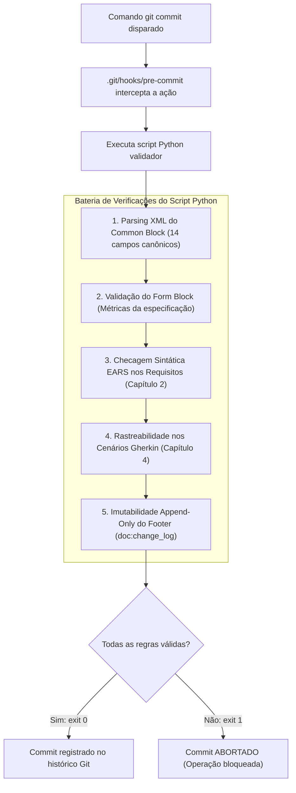

# Checklist Automatizado em Python e Validação de Pré-Commit

O **checklist automatizado em Python** atua como um **oráculo determinístico e barreira sintática local**, concebido para que os agentes de IA ou desenvolvedores humanos não consigam registrar no Git alterações que violem as normas de engenharia ou os esquemas de metadados do repositório.

---

## Checklist Automatizado em Python

O script validador opera como um analisador estático (*linter/parser*) independente.
Ele lê os arquivos Markdown gerenciados e executa um conjunto de verificações booleanas (PASS/FAIL) em quatro níveis sequenciais:



### Nível 1: Validação do Common Block (Tags XML `<doc:...>`)

* **Estrutura e Presença:** O script analisa se os 14 campos universais obrigatórios estão presentes no topo absoluto do arquivo Markdown (`<doc:schema_version>`, `<doc:file_type>`, `<doc:document_status>`, etc.).
* **Autoridade e Status:** Verifica se o agente não tentou promover o status indevidamente para `approved` sem o veredito formal exigido pelas normas ISO/IEC 42001 e 38507.
* **Custódia Singular (`doc:owner`):** Confirma se o agente que modificou o arquivo corresponde ao proprietário exclusivo daquele tipo documental (por exemplo, `srs-writer` para `spec-foundation` ou `architect` para `spec-architecture`).

### Nível 2: Validação do Form Block (`<spec-architecture:...>`)

* O script extrai os campos de máquina que alimentam os portões de qualidade (Gates de CI/CD), conferindo se as contagens batem com o que foi declarado (ex.: `<spec-architecture:completed_chapters>`, `<spec-architecture:component_count>`).

### Nível 3: Análise Sintática de Requisitos e Cenários (EARS e Gherkin)

* **Padrões EARS no Capítulo 2:** 
Analisa por expressões regulares (*regex*) se cada requisito declarado no Capítulo 2 segue estritamente um dos 5 padrões linguísticos da sintaxe EARS (`Ubíquo`, `Event-Driven`, `State-Driven`, `Unwanted Behavior` ou `Opcional`).
* **Oráculos Gherkin no Capítulo 4:** 
Confirma se os blocos delimitados por ` ```gherkin ` contêm a tríade léxica padronizada (`Dado`, `Quando`, `Então`) e a marcação de rastreabilidade explícita com o ID do requisito correspondente: `(traces: REQ-...)`.

### Nível 4: Integridade do Rodapé (Footer *Append-Only*)

* O script examina a tag `<doc:change_log>`, comparando o estado anterior com o atual para garantir que nenhuma linha de histórico prévia foi modificada ou removida, aceitando apenas a inclusão (*append*) de novas tags `<entry>` com timestamp UTC e agente identificado.

---

## Validação do Pré-Commit

A validação de pré-commit é executada diretamente pelo mecanismo nativo de **Git Hooks** da máquina do desenvolvedor (ou dentro do ambiente GitHub Codespaces):

1. **Localização do Hook:**  
   O arquivo de hook fica localizado em `.git/hooks/pre-commit` no repositório local.
2. **Momento da Interceptação:**  
   Assim que o agente ou o usuário digita `git commit -m "..."`, o Git congela a criação do commit e invoca imediatamente o script `.git/hooks/pre-commit` antes de gravar o objeto no repositório.
3. **Identificação dos Arquivos Afetados (*Staged Files*):**  
   O script roda o comando `git diff --cached --name-only --diff-filter=ACM` para obter apenas os arquivos `.md` que foram adicionados à área de preparação (*stage*) com `git add`.
4. **O Contrato de Saída (*Exit Code*):**  
   * **Se passar em 100% dos testes:** O script Python emite mensagem de sucesso e finaliza com `sys.exit(0)`. O Git reconhece o código de saída zero e conclui a gravação do commit no histórico da branch.
   * **Se qualquer validação falhar (ex.: tag XML malformada, requisito fora da sintaxe EARS ou campo obrigatório ausente):** O script imprime a linha e a regra violada no console de erro (`stderr`) e finaliza com `sys.exit(1)`. O Git interpreta qualquer saída diferente de zero como uma **falha bloqueante** e aborta sumariamente a operação. Nenhum commit é criado.

---

## 3. O Script em Prática

Para materializar esse conceito, veja a estrutura básica de um validador `scripts/validate_spec.py` e sua amarração no hook:

### O Script Python (`scripts/validate_spec.py`)

```python
#!/usr/bin/env python3
import sys
import re
from pathlib import Path

REQUIRED_DOC_TAGS = [
    "doc:schema_version", "doc:file_type", "doc:document_status",
    "doc:owner", "doc:project", "doc:purpose"
]

def validate_markdown(file_path: Path) -> bool:
    content = file_path.read_text(encoding="utf-8")
    errors = []

    # 1. Checa presença do Common Block
    for tag in REQUIRED_DOC_TAGS:
        if not re.search(rf"<{tag}>.*?</{tag}>", content):
            errors.append(f"Tag obrigatória ausente: <{tag}>")

    # 2. Impede autoaprovação não autorizada
    if "<doc:document_status>approved</doc:document_status>" in content:
        # Verifica se não há evidência humana registrada
        errors.append("Status 'approved' é exclusivo da autoridade humana e não pode ser comitado diretamente.")

    # 3. Valida sintaxe EARS no Capítulo 2
    if "### Capítulo 2" in content:
        req_pattern = re.compile(r"\\[REQ-[A-Z0-9]+-\d+\s*\|\s*(Ubíquo|Event-Driven|State-Driven|Unwanted Behavior|Opcional)\\]:")
        if not req_pattern.search(content):
            errors.append("Requisitos do Capítulo 2 devem seguir a fórmula EARS.")

    # 4. Valida Gherkin e Rastreabilidade no Capítulo 4
    if "```gherkin" in content and "(traces: REQ-" not in content:
        errors.append("Cenários Gherkin do Capítulo 4 exigem marcação explícita de rastreabilidade '(traces: REQ-...)'")

    if errors:
        print(f"\n[FAIL] Erros no arquivo: {file_path}", file=sys.stderr)
        for err in errors:
            print(f"  - {err}", file=sys.stderr)
        return False

    print(f"[PASS] {file_path} está em conformidade estrutural.")
    return True

if __name__ == "__main__":
    files = sys.argv[1:]
    all_valid = all(validate_markdown(Path(f)) for f in files if f.endswith(".md"))
    sys.exit(0 if all_valid else 1)
```

### O Git Hook (`.git/hooks/pre-commit`)

```bash
#!/usr/bin/env bash
# Coleta apenas os arquivos Markdown que estão no stage do commit
FILES=$(git diff --cached --name-only --diff-filter=ACM | grep '\.md$' || true)

if [ -n "$FILES" ]; then
    python3 scripts/validate_spec.py $FILES
    EXIT_CODE=$?
    if [ $EXIT_CODE -ne 0 ]; then
        echo "COMMIT ABORTADO: Corrija os erros estruturais acima antes de comitar."
        exit 1
    fi
fi

exit 0
```

---

## 4. Limitações e Defesa em Profundidade

Conforme comprovado nos relatórios de auditoria e segurança da infraestrutura:

* **Hooks de Git locais não são barreiras de segurança absolutas:** 
Um agente de IA com acesso ao shell pode tentar forçar o commit utilizando `git commit --no-verify`, ignorando o hook de pré-commit.
* **A Proteção Definitiva Reside no Servidor:** 
Por essa razão, a arquitetura do projeto implementa a **defesa em profundidade**: 
o pré-commit serve como retorno imediato e barato para o desenvolvedor; contudo, a trava inviolável é imposta na esteira remota do GitHub (via **Branch Protection Rules** e a assinatura exclusiva do **GitHub App ID 5476799** com o check `eud-gate/verified`), impedindo qualquer mesclagem na branch principal se o código não tiver sido aprovado pelo validador independente.