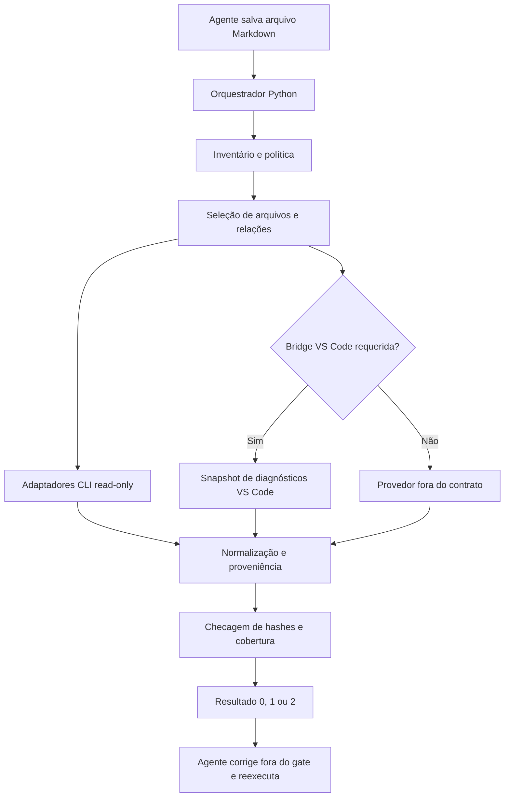

# Especificação Técnica Completa — Gate determinístico de qualidade

**Papel:** definir desenho de execução para os requisitos já especificados, sem
alegar código existente ou assumir decisões humanas pendentes.  
**Objetivo:** permitir implementar o script Python com provedores CLI read-only
e, se autorizado, bridge VS Code para diagnósticos exclusivos de extensões.  
**Escopo:** WS Linux no VS Code, repositório `selecao-brasileira`, alterações
Markdown e linguagens condicionais.  
**Documentos base:** [BRD/URS](./BRD_URS_Verificador_Qualidade.md#brd-root) e
[FRS/SyRS v2](./FRS_SyRS_Verificador_Qualidade_Deterministica_v2.0.md#frs-root).

## TEC-ROOT

## 1. Convenções e arquitetura

- **Orquestrador:** Python 3, biblioteca padrão, execução no terminal, sem
  alteração de arquivos fonte.
- **Adaptador:** interface estável que representa uma CLI autorizada ou fonte de
  diagnóstico externo.
- **Profile:** conjunto explícito de provedores/regras aplicáveis a um escopo.
- **Snapshot:** estado de arquivos/configuração/versão usado para classificar a
  rodada.
- **Gate:** agregação de resultados com código 0, 1 ou 2.

Arquitetura lógica:



**Não usar a extensão como executável:** a lista de `code --list-extensions`
informa IDs e versões de extensões. A execução por CLI depende do binário
separado, de suas configurações e de disponibilidade comprovada.

## 2. Catálogo de provedores — implementação por perfis

| Adaptador            | Identificador no inventário                                       | Prova de capacidade                                                            | Invocação ilustrativa (exige disponibilidade real)   | Saída esperada                                    |
| -------------------- | ----------------------------------------------------------------- | ------------------------------------------------------------------------------ | ---------------------------------------------------- | ------------------------------------------------- |
| `markdownlint`       | `davidanson.vscode-markdownlint`                                  | [EXT-01](./FRS_SyRS_Verificador_Qualidade_Deterministica_v2.0.md#fontes)       | `markdownlint-cli2 AGENTS.md`                        | Formato da CLI/formatter configurado, native exit |
| `link-check`         | `buckethsu.adocmd-forge` para UX, validador repositório para gate | [EXT-02/03](./FRS_SyRS_Verificador_Qualidade_Deterministica_v2.0.md#fontes)    | Adaptador de código do repositório, se comprovado    | Arquivo+fragmento e estado                        |
| `prettier`           | `esbenp.prettier-vscode`                                          | [EXT-06](./FRS_SyRS_Verificador_Qualidade_Deterministica_v2.0.md#fontes)       | `prettier --check documento.md`                      | Arquivo divergente; localização opcional          |
| `pyright`            | `ms-pyright.pyright`                                              | [EXT-04](./FRS_SyRS_Verificador_Qualidade_Deterministica_v2.0.md#fontes)       | `pyright --outputjson`                               | JSON com range 0-based                            |
| `eslint`             | `dbaeumer.vscode-eslint`                                          | [EXT-10](./FRS_SyRS_Verificador_Qualidade_Deterministica_v2.0.md#fontes)       | `eslint -f json src/app.js`                          | JSON por arquivo                                  |
| `spectral`           | `stoplight.spectral`                                              | [EXT-11](./FRS_SyRS_Verificador_Qualidade_Deterministica_v2.0.md#fontes)       | `spectral lint api.yaml -f json --quiet`             | JSON com regras/ranges                            |
| `redocly`            | `redocly.openapi-vs-code`                                         | [EXT-12](./FRS_SyRS_Verificador_Qualidade_Deterministica_v2.0.md#fontes)       | `redocly lint api.yaml --format=json`                | JSON por regra e localização                      |
| `yaml`               | `redhat.vscode-yaml`                                              | [EXT-13/14](./FRS_SyRS_Verificador_Qualidade_Deterministica_v2.0.md#fontes)    | Via bridge VS Code ou CLI YAML selecionada e testada | Diagnósticos YAML/esquema                         |
| `cargo`              | Sem extensão Rust declarada                                       | [EXT-07/08/18](./FRS_SyRS_Verificador_Qualidade_Deterministica_v2.0.md#fontes) | `cargo check --message-format=json`                  | rustc JSON; somente projeto Cargo                 |
| `clippy`             | Sem extensão Rust declarada                                       | [EXT-18](./FRS_SyRS_Verificador_Qualidade_Deterministica_v2.0.md#fontes)       | `cargo clippy --message-format=json`                 | Diagnósticos JSON; somente projeto Cargo          |
| `rustfmt`            | Sem extensão Rust declarada                                       | [EXT-08](./FRS_SyRS_Verificador_Qualidade_Deterministica_v2.0.md#fontes)       | `cargo fmt --all -- --check`                         | Arquivo/estado da formatação                      |
| `vscode-diagnostics` | AdocMD, Pylance, YAML e outros autorizados                        | [EXT-02](./FRS_SyRS_Verificador_Qualidade_Deterministica_v2.0.md#fontes)       | Bridge oficial própria quando implantada             | Exportação versionada e frescor                   |

**Exemplo não é instrução para instalar:** a escolha do executável, sua versão e
o diretório de trabalho devem ser validados antes de executar. Comandos somente
se aplicam a artefatos pertencentes ao domínio da ferramenta.

## TEC-001

**Componentes e responsabilidades.**

**Requisitos relacionados:**
[FR-001](./FRS_SyRS_Verificador_Qualidade_Deterministica_v2.0.md#fr-001),
[FR-003](./FRS_SyRS_Verificador_Qualidade_Deterministica_v2.0.md#fr-003),
[FR-004](./FRS_SyRS_Verificador_Qualidade_Deterministica_v2.0.md#fr-004),
[FR-025](./FRS_SyRS_Verificador_Qualidade_Deterministica_v2.0.md#fr-025).  
**Testes relacionados:**
[TST-013](./FRS_SyRS_Verificador_Qualidade_Deterministica_v2.0.md#tst-013),
[TST-021](./FRS_SyRS_Verificador_Qualidade_Deterministica_v2.0.md#tst-021).

**Módulos lógicos mínimos:** `cli` (parâmetros), `workspace`
(raiz/escopo/arquivos), `registry` (perfil e autorização), `runner`
(subprocessos), `parsers` (formatos nativos), `links` (links/âncoras), `trace`
(aresta e recíproca), `report` (terminal e JSON), `gate` (decisão). São
componentes do mesmo script ou módulos somente se a implementação demonstrar
necessidade; não implicam nove arquivos.

**Contrato:** chamada do Python usa configuração explícita e nenhum
`shell=True`, respeitando limites de tempo, cwd, encoding e ambiente. Falhas são
resultados, não exceções ocultas.

**Rastreio:** FR-001, FR-003, FR-004, FR-025; TST-001, TST-013.

## TEC-002

**Descoberta e escopo.**

**Requisitos relacionados:**
[FR-002](./FRS_SyRS_Verificador_Qualidade_Deterministica_v2.0.md#fr-002),
[FR-013](./FRS_SyRS_Verificador_Qualidade_Deterministica_v2.0.md#fr-013),
[FR-034](./FRS_SyRS_Verificador_Qualidade_Deterministica_v2.0.md#fr-034),
[FR-035](./FRS_SyRS_Verificador_Qualidade_Deterministica_v2.0.md#fr-035).  
**Testes relacionados:**
[TST-007](./FRS_SyRS_Verificador_Qualidade_Deterministica_v2.0.md#tst-007),
[TST-011](./FRS_SyRS_Verificador_Qualidade_Deterministica_v2.0.md#tst-011),
[TST-012](./FRS_SyRS_Verificador_Qualidade_Deterministica_v2.0.md#tst-012),
[TST-017](./FRS_SyRS_Verificador_Qualidade_Deterministica_v2.0.md#tst-017),
[TST-020](./FRS_SyRS_Verificador_Qualidade_Deterministica_v2.0.md#tst-020),
[TST-025](./FRS_SyRS_Verificador_Qualidade_Deterministica_v2.0.md#tst-025),
[TST-032](./FRS_SyRS_Verificador_Qualidade_Deterministica_v2.0.md#tst-032),
[TST-033](./FRS_SyRS_Verificador_Qualidade_Deterministica_v2.0.md#tst-033),
[TST-039](./FRS_SyRS_Verificador_Qualidade_Deterministica_v2.0.md#tst-039),
[TST-040](./FRS_SyRS_Verificador_Qualidade_Deterministica_v2.0.md#tst-040).

**Entrada:** `--scope changed|all` ou lista de arquivos, cwd e eventual
configuração.

**Algoritmo:** (1) identificar raiz Git sem mutá-lo; (2) enumerar modificados
via `git diff --name-only`, staged via `git diff --cached --name-only` e novos
via `git ls-files --others --exclude-standard` (considerar exclusões e renames);
(3) validar cada path pela raiz, incluindo symlink/traversal; (4) classificar
tipos e impacto; (5) expandir dependências de links bidirecionais conhecidos;
(6) ordenar resultados por path normalizado.

**Parada:** se não for possível provar o conjunto de arquivos coberto por um
requisito obrigatório, retorno 2. Não desabilitar automaticamente um problema
histórico. Sem `.md` alterado, não acionar gate de Markdown só porque o projeto
tem arquivos `.md`.

**Rastreio:** FR-002, FR-013, FR-034, FR-035; TST-017, TST-021, TST-033,
TST-039.

## TEC-003

**Registro, ativação e disponibilidade.**

**Requisitos relacionados:**
[FR-022](./FRS_SyRS_Verificador_Qualidade_Deterministica_v2.0.md#fr-022),
[FR-026](./FRS_SyRS_Verificador_Qualidade_Deterministica_v2.0.md#fr-026),
[FR-031](./FRS_SyRS_Verificador_Qualidade_Deterministica_v2.0.md#fr-031),
[FR-032](./FRS_SyRS_Verificador_Qualidade_Deterministica_v2.0.md#fr-032),
[FR-036](./FRS_SyRS_Verificador_Qualidade_Deterministica_v2.0.md#fr-036).  
**Testes relacionados:**
[TST-008](./FRS_SyRS_Verificador_Qualidade_Deterministica_v2.0.md#tst-008),
[TST-009](./FRS_SyRS_Verificador_Qualidade_Deterministica_v2.0.md#tst-009),
[TST-027](./FRS_SyRS_Verificador_Qualidade_Deterministica_v2.0.md#tst-027),
[TST-028](./FRS_SyRS_Verificador_Qualidade_Deterministica_v2.0.md#tst-028),
[TST-031](./FRS_SyRS_Verificador_Qualidade_Deterministica_v2.0.md#tst-031),
[TST-035](./FRS_SyRS_Verificador_Qualidade_Deterministica_v2.0.md#tst-035),
[TST-036](./FRS_SyRS_Verificador_Qualidade_Deterministica_v2.0.md#tst-036),
[TST-037](./FRS_SyRS_Verificador_Qualidade_Deterministica_v2.0.md#tst-037),
[TST-038](./FRS_SyRS_Verificador_Qualidade_Deterministica_v2.0.md#tst-038).

**Campos:** `id`, `source_extension_id`, `domain`, `mode` (`CLI`, `VS_CODE`,
`REPOSITORY`), `applicability`, `required`, `executable`, `argv_template`,
`version_probe`, `config_hash`, `timeout_seconds`, `severity_policy`,
`parser_id`.

**Algoritmo:** catálogo allowlist aprovado → checar pertinência por
arquivo/configuração → localizar executável no `PATH` efetivo WSL → obter versão
sem instalar → validar configuração → executar ou registrar
NOT_APPLICABLE/UNAVAILABLE. Se required e UNAVAILABLE, exit 2. Se opcional
ausente, registrar OPTIONAL_SKIPPED, sem PASS fictício.

**Bridge VS Code:** a API `vscode.languages.getDiagnostics()` não é acessível
diretamente por processo Python externo. Uma extensão-ponte autorizada pode
coletar diagnósticos e exportar snapshot com `uri`, `range`, `severity`, `code`,
`source` quando fornecido, lista de arquivos cobertos e carimbo de revisão. A
API não garante cobertura de arquivos nunca analisados: é necessário protocolo
de disponibilidade e frescor. Não executar `adocmdForge.validateLinks` por
shell.

**Rastreio:** FR-022, FR-026, FR-031, FR-032, FR-036; TST-008, TST-009, TST-027,
TST-028, TST-035.

## TEC-004

**Verificação de links e relações.**

**Requisitos relacionados:**
[FR-010](./FRS_SyRS_Verificador_Qualidade_Deterministica_v2.0.md#fr-010),
[FR-011](./FRS_SyRS_Verificador_Qualidade_Deterministica_v2.0.md#fr-011),
[FR-012](./FRS_SyRS_Verificador_Qualidade_Deterministica_v2.0.md#fr-012),
[FR-033](./FRS_SyRS_Verificador_Qualidade_Deterministica_v2.0.md#fr-033),
[FR-034](./FRS_SyRS_Verificador_Qualidade_Deterministica_v2.0.md#fr-034),
[FR-038](./FRS_SyRS_Verificador_Qualidade_Deterministica_v2.0.md#fr-038).  
**Testes relacionados:**
[TST-003](./FRS_SyRS_Verificador_Qualidade_Deterministica_v2.0.md#tst-003),
[TST-004](./FRS_SyRS_Verificador_Qualidade_Deterministica_v2.0.md#tst-004),
[TST-005](./FRS_SyRS_Verificador_Qualidade_Deterministica_v2.0.md#tst-005),
[TST-006](./FRS_SyRS_Verificador_Qualidade_Deterministica_v2.0.md#tst-006),
[TST-020](./FRS_SyRS_Verificador_Qualidade_Deterministica_v2.0.md#tst-020),
[TST-030](./FRS_SyRS_Verificador_Qualidade_Deterministica_v2.0.md#tst-030),
[TST-033](./FRS_SyRS_Verificador_Qualidade_Deterministica_v2.0.md#tst-033),
[TST-035](./FRS_SyRS_Verificador_Qualidade_Deterministica_v2.0.md#tst-035).

**Links:** resolver URI relativa a partir do diretório do arquivo, decodificar
fragmento, rejeitar escapes de raiz, validar arquivo existente e heading/âncora
conforme algoritmo declarado. Os fragmentos de destinos distintos não são
verificados pela MD051 do markdownlint; usar verificador específico e fixtures
para colisões, unicode, espaços, títulos repetidos e links malformados.

**Relações:** modelar `edge=(origem_id,tipo, destino_id, tipo_inverso)` segundo
metamodelo vigente; duplicação indevida refere-se à identidade semântica da
aresta, não ao número de vezes em que a documentação exibe o mesmo link;
verificar destino, origem, inversa e coexistência de tipos.

**Restrições:** não reescrever IDs publicados; não deletar comentários HTML; não
aceitar que texto contenha a string de um caminho como comprovação de link
resolvido. Utilizar validador existente apenas após inspecionar cobertura, por
causa dos falsos negativos relatados.

**Rastreio:** FR-010, FR-011, FR-012, FR-033, FR-034, FR-038; TST-003/006,
TST-020, TST-033.

## TEC-005

**Algoritmo do gate e máquina de estados.**

**Requisitos relacionados:**
[FR-014](./FRS_SyRS_Verificador_Qualidade_Deterministica_v2.0.md#fr-014),
[FR-015](./FRS_SyRS_Verificador_Qualidade_Deterministica_v2.0.md#fr-015),
[FR-018](./FRS_SyRS_Verificador_Qualidade_Deterministica_v2.0.md#fr-018),
[FR-019](./FRS_SyRS_Verificador_Qualidade_Deterministica_v2.0.md#fr-019),
[FR-021](./FRS_SyRS_Verificador_Qualidade_Deterministica_v2.0.md#fr-021),
[FR-032](./FRS_SyRS_Verificador_Qualidade_Deterministica_v2.0.md#fr-032),
[FR-038](./FRS_SyRS_Verificador_Qualidade_Deterministica_v2.0.md#fr-038).  
**Testes relacionados:**
[TST-001](./FRS_SyRS_Verificador_Qualidade_Deterministica_v2.0.md#tst-001),
[TST-008](./FRS_SyRS_Verificador_Qualidade_Deterministica_v2.0.md#tst-008),
[TST-012](./FRS_SyRS_Verificador_Qualidade_Deterministica_v2.0.md#tst-012),
[TST-013](./FRS_SyRS_Verificador_Qualidade_Deterministica_v2.0.md#tst-013),
[TST-014](./FRS_SyRS_Verificador_Qualidade_Deterministica_v2.0.md#tst-014),
[TST-018](./FRS_SyRS_Verificador_Qualidade_Deterministica_v2.0.md#tst-018),
[TST-019](./FRS_SyRS_Verificador_Qualidade_Deterministica_v2.0.md#tst-019),
[TST-024](./FRS_SyRS_Verificador_Qualidade_Deterministica_v2.0.md#tst-024),
[TST-026](./FRS_SyRS_Verificador_Qualidade_Deterministica_v2.0.md#tst-026),
[TST-033](./FRS_SyRS_Verificador_Qualidade_Deterministica_v2.0.md#tst-033),
[TST-036](./FRS_SyRS_Verificador_Qualidade_Deterministica_v2.0.md#tst-036),
[TST-037](./FRS_SyRS_Verificador_Qualidade_Deterministica_v2.0.md#tst-037).

**Estados de provedores:** REQUIRED_PASS, REQUIRED_FAIL, UNAVAILABLE,
NOT_APPLICABLE, OPTIONAL_SKIPPED, NOT_VERIFIED. O estado individual nasce de
execução comprovada, nunca de detecção de extensão.

**Precedência:** (i) se required com falha de coleta, parsing, configuração,
tempo ou estabilidade → `exit 2`; (ii) senão, se required com diagnóstico
bloqueante → `exit 1`; (iii) senão, se todas as verificações obrigatórias
completas e conformes → `exit 0`; (iv) outras situações → `exit 2`. Não usar
exit `0` se conjunto obrigatório estiver vazio por erro de configuração.

**Severidade:** `native_severity` é preservada; `effective_severity` deriva da
política decidida pelo usuário. Um CLI `0` com warnings não autoriza ignorá-los
se o contrato os tornar bloqueantes.

**Estado estável:** hash dos arquivos/configurações no início e fim; se houver
alteração durante a rodada, `exit 2` e rodar de novo após salvar. A opção
`--scope all` não equivale a homologação de toda a aplicação.

**Rastreio:** FR-014, FR-015, FR-018, FR-019, FR-021, FR-032; TST-001, TST-013,
TST-014, TST-018, TST-019, TST-037.

## TEC-006

**Normalização, relatório e soluções.**

**Requisitos relacionados:**
[FR-006](./FRS_SyRS_Verificador_Qualidade_Deterministica_v2.0.md#fr-006),
[FR-007](./FRS_SyRS_Verificador_Qualidade_Deterministica_v2.0.md#fr-007),
[FR-008](./FRS_SyRS_Verificador_Qualidade_Deterministica_v2.0.md#fr-008),
[FR-009](./FRS_SyRS_Verificador_Qualidade_Deterministica_v2.0.md#fr-009),
[FR-016](./FRS_SyRS_Verificador_Qualidade_Deterministica_v2.0.md#fr-016),
[FR-017](./FRS_SyRS_Verificador_Qualidade_Deterministica_v2.0.md#fr-017),
[FR-023](./FRS_SyRS_Verificador_Qualidade_Deterministica_v2.0.md#fr-023),
[FR-024](./FRS_SyRS_Verificador_Qualidade_Deterministica_v2.0.md#fr-024).  
**Testes relacionados:**
[TST-002](./FRS_SyRS_Verificador_Qualidade_Deterministica_v2.0.md#tst-002),
[TST-007](./FRS_SyRS_Verificador_Qualidade_Deterministica_v2.0.md#tst-007),
[TST-010](./FRS_SyRS_Verificador_Qualidade_Deterministica_v2.0.md#tst-010),
[TST-016](./FRS_SyRS_Verificador_Qualidade_Deterministica_v2.0.md#tst-016),
[TST-022](./FRS_SyRS_Verificador_Qualidade_Deterministica_v2.0.md#tst-022),
[TST-023](./FRS_SyRS_Verificador_Qualidade_Deterministica_v2.0.md#tst-023).

**Diagnóstico normalizado:** `id`, `provider_id`, `origin`, `rule`,
`native_severity`, `effective_severity`, `file`, `line`, `column`, `message`,
`raw_location`, `evidence_id`, `suggestion_class`, `suggestion`. A proveniência
CLI não deve ser substituída pelo nome da extensão correspondente; linha/coluna
ausentes ficam null.

**Normalização de coordenadas:** converter base zero de Pyright para
apresentação humana 1-based, guardando também a faixa nativa; não assumir que
todos os provedores usam a mesma base.

**Remediação:** `DETERMINISTICA` somente com regra e transformação unívoca
testada; `PROPOSTA_A_REVISAR` em múltiplas opções; `NAO_DETERMINADA` quando
falta causa. Não apresentar texto como causa raiz sem evidência.

**Saída terminal:** `arquivo:linha:coluna` quando observado, status, regra,
provedor, causa diagnosticada, possível correção e link de evidência. **Saída
JSON:** campos fixos, ordenação determinística, resumo de cobertura, comandos
sanitizados e códigos nativos. Nunca fabricar posição para Prettier quando só
fornece nome de arquivo.

**Rastreio:** FR-006/009, FR-016/017, FR-023/024; TST-007, TST-010, TST-016,
TST-022.

## TEC-007

**Segurança e não mutação.**

**Requisitos relacionados:**
[FR-004](./FRS_SyRS_Verificador_Qualidade_Deterministica_v2.0.md#fr-004),
[FR-015](./FRS_SyRS_Verificador_Qualidade_Deterministica_v2.0.md#fr-015),
[FR-017](./FRS_SyRS_Verificador_Qualidade_Deterministica_v2.0.md#fr-017),
[FR-020](./FRS_SyRS_Verificador_Qualidade_Deterministica_v2.0.md#fr-020),
[FR-031](./FRS_SyRS_Verificador_Qualidade_Deterministica_v2.0.md#fr-031),
[FR-037](./FRS_SyRS_Verificador_Qualidade_Deterministica_v2.0.md#fr-037).  
**Testes relacionados:**
[TST-001](./FRS_SyRS_Verificador_Qualidade_Deterministica_v2.0.md#tst-001),
[TST-014](./FRS_SyRS_Verificador_Qualidade_Deterministica_v2.0.md#tst-014),
[TST-015](./FRS_SyRS_Verificador_Qualidade_Deterministica_v2.0.md#tst-015),
[TST-016](./FRS_SyRS_Verificador_Qualidade_Deterministica_v2.0.md#tst-016),
[TST-021](./FRS_SyRS_Verificador_Qualidade_Deterministica_v2.0.md#tst-021),
[TST-023](./FRS_SyRS_Verificador_Qualidade_Deterministica_v2.0.md#tst-023),
[TST-027](./FRS_SyRS_Verificador_Qualidade_Deterministica_v2.0.md#tst-027),
[TST-029](./FRS_SyRS_Verificador_Qualidade_Deterministica_v2.0.md#tst-029),
[TST-035](./FRS_SyRS_Verificador_Qualidade_Deterministica_v2.0.md#tst-035).

**Proibições:** não usar `shell=True`, não executar comandos extraídos de
Markdown, não instalar pacotes implicitamente, não passar arquivos pessoais em
logs, não chamar rede quando não autorizada, não executar `--fix` ou `--write`
no gate. Usar subprocessos com `cwd` explícito, ambiente mínimo e timeout.

**Dado pessoal:** mascarar segredos/tokens, linhas de texto e valores de
telefone; reportar regra/arquivo/posição e contexto estritamente necessário.
`stdout`/`stderr` brutos devem ser tratados como potencialmente sensíveis; só
persistir se política permitir e protegidos.

**Hash:** SHA-256 de entradas e configurações relevantes, inclusive comentários
HTML; se diferirem antes/depois da verificação, invalidar rodada. Não produzir
logs dentro de `.md` nem alterar arquivos do repositório por padrão.

**Rastreio:** FR-004, FR-015, FR-017, FR-020, FR-031, FR-037; TST-015, TST-021,
TST-023.

## TEC-008

**Exemplos de interface e estrutura JSON.**

**Requisitos relacionados:**
[FR-007](./FRS_SyRS_Verificador_Qualidade_Deterministica_v2.0.md#fr-007),
[FR-016](./FRS_SyRS_Verificador_Qualidade_Deterministica_v2.0.md#fr-016),
[FR-017](./FRS_SyRS_Verificador_Qualidade_Deterministica_v2.0.md#fr-017).  
**Testes relacionados:**
[TST-002](./FRS_SyRS_Verificador_Qualidade_Deterministica_v2.0.md#tst-002),
[TST-007](./FRS_SyRS_Verificador_Qualidade_Deterministica_v2.0.md#tst-007),
[TST-016](./FRS_SyRS_Verificador_Qualidade_Deterministica_v2.0.md#tst-016),
[TST-023](./FRS_SyRS_Verificador_Qualidade_Deterministica_v2.0.md#tst-023).

**Comando conceitual, não executado:**

```bash
python3 scripts/verificar-qualidade.py --scope changed --format json
```

**JSON ilustrativo:**

```json
{
  "schema_version": "2.0-proposta",
  "scope": "changed",
  "snapshot": { "stable": true, "inputs_sha256": "<sha256>" },
  "providers": [
    {
      "id": "markdownlint",
      "origin": "CLI",
      "required": true,
      "status": "REQUIRED_FAIL",
      "native_exit": 1
    }
  ],
  "diagnostics": [
    {
      "provider_id": "markdownlint",
      "rule": "MD056",
      "native_severity": "error",
      "effective_severity": "error",
      "file": "documento.md",
      "line": 42,
      "column": 1,
      "suggestion_class": "PROPOSTA_A_REVISAR",
      "evidence_id": "D-001"
    }
  ],
  "required_checks": { "passed": 0, "failed": 1, "unavailable": 0 },
  "exit_code": 1
}
```

**Invariante:** o JSON é formato lógico proposto; a implementação futura deve
validar seu schema com testes sintéticos e emitir o mesmo tipo de resultado em
stdout e log, sem expor dados sensíveis.

## TEC-009

**Oráculos, testes e integração de contrato.**

**Requisitos relacionados:**
[FR-018](./FRS_SyRS_Verificador_Qualidade_Deterministica_v2.0.md#fr-018),
[FR-021](./FRS_SyRS_Verificador_Qualidade_Deterministica_v2.0.md#fr-021),
[FR-023](./FRS_SyRS_Verificador_Qualidade_Deterministica_v2.0.md#fr-023),
[FR-024](./FRS_SyRS_Verificador_Qualidade_Deterministica_v2.0.md#fr-024).  
**Testes relacionados:**
[TST-001](./FRS_SyRS_Verificador_Qualidade_Deterministica_v2.0.md#tst-001),
[TST-019](./FRS_SyRS_Verificador_Qualidade_Deterministica_v2.0.md#tst-019),
[TST-024](./FRS_SyRS_Verificador_Qualidade_Deterministica_v2.0.md#tst-024).

**Estratégia:** congelar entradas sintéticas e oráculos antes da implementação
(TDD); executar primeiro teste negativo, implementar transformação mínima,
repetir positivos, regressões e integração. Não assumir que um PASS de TST
valida toda a FRS.

**Teste de fronteira:** provedores CLI bloqueantes e opcionais, caminhos fora da
raiz, configurações conflitantes, outputs malformados, stdout misturando logs
com JSON, buffer não salvo, diferentes bases de linha e relações duplicadas.

**Rastreabilidade:** requisitos
[FR-001](./FRS_SyRS_Verificador_Qualidade_Deterministica_v2.0.md#fr-001) a
[FR-038](./FRS_SyRS_Verificador_Qualidade_Deterministica_v2.0.md#fr-038);
[TST-001](./FRS_SyRS_Verificador_Qualidade_Deterministica_v2.0.md#tst-001) a
[TST-040](./FRS_SyRS_Verificador_Qualidade_Deterministica_v2.0.md#tst-040). A
rastreabilidade documental descreve relações propostas; execução depende de
futura implementação.

## TEC-010

**Plano mínimo de verificação da implementação.**

**Requisitos relacionados:**
[FR-005](./FRS_SyRS_Verificador_Qualidade_Deterministica_v2.0.md#fr-005),
[FR-027](./FRS_SyRS_Verificador_Qualidade_Deterministica_v2.0.md#fr-027),
[FR-028](./FRS_SyRS_Verificador_Qualidade_Deterministica_v2.0.md#fr-028),
[FR-029](./FRS_SyRS_Verificador_Qualidade_Deterministica_v2.0.md#fr-029),
[FR-030](./FRS_SyRS_Verificador_Qualidade_Deterministica_v2.0.md#fr-030).  
**Testes relacionados:**
[TST-002](./FRS_SyRS_Verificador_Qualidade_Deterministica_v2.0.md#tst-002),
[TST-010](./FRS_SyRS_Verificador_Qualidade_Deterministica_v2.0.md#tst-010),
[TST-025](./FRS_SyRS_Verificador_Qualidade_Deterministica_v2.0.md#tst-025),
[TST-026](./FRS_SyRS_Verificador_Qualidade_Deterministica_v2.0.md#tst-026),
[TST-027](./FRS_SyRS_Verificador_Qualidade_Deterministica_v2.0.md#tst-027),
[TST-028](./FRS_SyRS_Verificador_Qualidade_Deterministica_v2.0.md#tst-028),
[TST-029](./FRS_SyRS_Verificador_Qualidade_Deterministica_v2.0.md#tst-029),
[TST-034](./FRS_SyRS_Verificador_Qualidade_Deterministica_v2.0.md#tst-034),
[TST-039](./FRS_SyRS_Verificador_Qualidade_Deterministica_v2.0.md#tst-039).

**Pré-requisitos:** contrato DH-01/02/03 aprovado; snapshot fixo;
disponibilidade das CLIs e configurações de projeto mapeadas; sem substituição
de validadores já existentes.

**Sequência:** (1) testes unitários de seleção, parsing e agregação; (2)
fixtures de links/reciprocidade; (3) execução read-only com CLI real; (4)
integração VS Code somente se requerida; (5) testes de regressão; (6) inspeção
de logs e hashes; (7) classificação de cada requisito como
PASS/FAIL/NOT_VERIFIED.

**Parada:** erro de infraestrutura exigida → exit 2; falha funcional → exit 1;
todas as obrigações completas → exit 0.

**Aceite:** a especificação técnica não autoriza implantação por si; somente o
código real testado poderá demonstrar o comportamento. Responsável decide a
promoção do gate.

## 3. Matriz de decisões e custos

| Escolha                      | Benefício                                   | Risco/custo                                            | Condição de decisão                                                      |
| ---------------------------- | ------------------------------------------- | ------------------------------------------------------ | ------------------------------------------------------------------------ |
| Só CLI + validadores repo    | Simplicidade, executável fora do editor     | Não captura problemas exclusivos do Pylance/AdocMD     | Usuário aceita equivalência parcial declarada                            |
| CLI + ponte VS Code          | Captura de provedores do editor no snapshot | Integração adicional, sincronização e frescor difíceis | Usuário exige captura literal e aprova implantação da ponte              |
| Todos os formatadores juntos | Nenhum benefício automático demonstrado     | Regras conflitantes e redundância                      | Somente quando requisitos de projeto demonstrarem necessidade            |
| Um linter OpenAPI escolhido  | Rápido e reproduzível por ruleset           | Pode não cobrir auditorias especializadas              | Política especifica qualidade exigida; complementos só por justificativa |

**Recomendação técnica condicionada:** iniciar pelo orquestrador CLI e
validadores internos comprovados, mantendo a ponte como requisito condicional de
DH-01. Isso não significa ignorar uma ferramenta que o usuário tornar
obrigatória.

## 4. Registro de alterações e compatibilidade com v1.0

- O conjunto histórico FR-001..025, NFR-001..011, TST-001..024 foi preservado na
  FRS/SyRS v2.
- Foram adicionados FR-026..038, NFR-012..015 e TST-025..040 para cobrir as
  diferenças demonstradas pelo inventário.
- As 50 extensões informadas foram incluídas no inventário, e CLIs não foram
  declaradas instaladas sem execução.
- Scripts do repositório, `AGENTS.md` e outros documentos existentes não foram
  editados.

## 5. Fontes técnicas oficiais

- **EXT-01:**
  [markdownlint-cli2 / CLI e configurações](https://github.com/DavidAnson/markdownlint-cli2/blob/main/README.md).
- **EXT-02:**
  [VS Code API / languages.getDiagnostics](https://code.visualstudio.com/api/references/vscode-api#languages).
- **EXT-03:**
  [VS Code / validação de links Markdown](https://code.visualstudio.com/docs/languages/markdown#_link-validation).
- **EXT-04:**
  [Pyright / CLI](https://github.com/microsoft/pyright/blob/main/docs/command-line.md).
- **EXT-05:**
  [Pyright / Pylance](https://github.com/microsoft/pyright/blob/main/docs/installation.md).
- **EXT-06:** [Prettier / CLI](https://prettier.io/docs/cli).
- **EXT-07:**
  [Cargo / formatos de mensagens](https://doc.rust-lang.org/cargo/reference/external-tools.html).
- **EXT-08:**
  [rustfmt / verificação](https://github.com/rust-lang/rustfmt#verifying-code-is-formatted).
- **EXT-09:**
  [NASA SWE-052](https://swehb.nasa.gov/spaces/SWEHBVD/pages/102695427/SWE-052+-+Bidirectional+Traceability).
- **EXT-10:**
  [ESLint / CLI](https://eslint.org/docs/latest/use/command-line-interface).
- **EXT-11:**
  [Spectral / CLI](https://github.com/stoplightio/spectral/blob/develop/docs/guides/2-cli.md).
- **EXT-12:** [Redocly / CLI lint](https://redocly.com/docs/cli/commands/lint).
- **EXT-13:**
  [Red Hat / servidor de YAML](https://github.com/redhat-developer/yaml-language-server).
- **EXT-14:**
  [Red Hat / vscode-yaml](https://github.com/redhat-developer/vscode-yaml).
- **EXT-15:**
  [vscode-markdownlint / paridade com CLI](https://marketplace.visualstudio.com/items?itemName=DavidAnson.vscode-markdownlint).
- **EXT-16:**
  [Prettier / extensão](https://marketplace.visualstudio.com/items?itemName=esbenp.prettier-vscode).
- **EXT-17:**
  [Prettier ESLint / extensão](https://marketplace.visualstudio.com/items?itemName=rvest.vs-code-prettier-eslint).
- **EXT-18:**
  [Rust Clippy / execução](https://github.com/rust-lang/rust-clippy).

## 6. Status de entrega

**SUSTENTADO INTEGRALMENTE:** existência dos três documentos criados nesta
entrega e rastreabilidade textual por IDs e links relativos entre eles, sujeita
a inspeção de âncoras no editor real.  
**SUSTENTADO PARCIALMENTE:** capacidades documentadas das ferramentas, sem
execução no ambiente do usuário.  
**NÃO VERIFICADO:** disponibilidade das CLIs, integração com a aba Problems,
script implementado, hashes do repositório e aprovação de testes reais.  
**DECISÃO_HUMANA:** DH-01, DH-02, DH-03.  
**FORA_DO_ESCOPO:** implementação do script ou edição de `AGENTS.md` e outros
arquivos do repositório.
