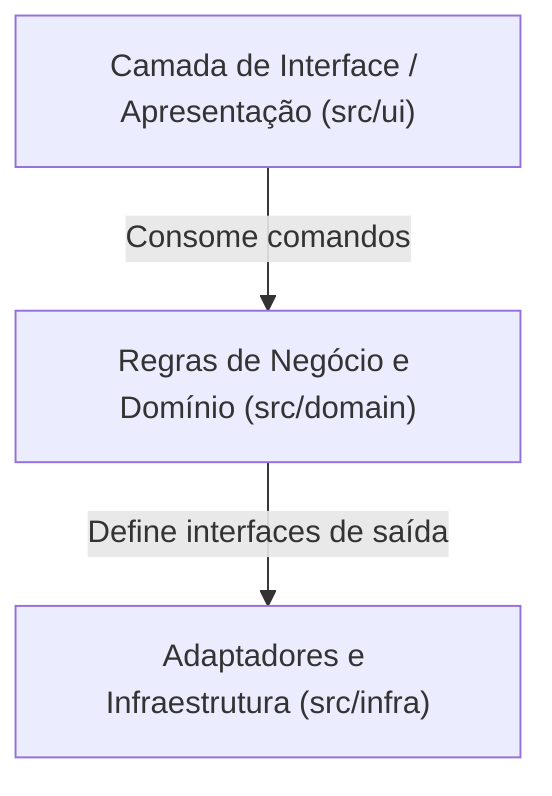

<!-- COMMON BLOCK | DO NOT MODIFY STRUCTURE OR FIELD NAMES -->
# Identification

<doc:schema_version>0.0</doc:schema_version>
<doc:file_type>spec-architecture</doc:file_type>
<doc:form_block_cardinality>single</doc:form_block_cardinality>
<doc:language>pt-BR</doc:language>

## Document State

<doc:document_status>draft</doc:document_status>

## Workflow

<doc:owner>srs-writer</doc:owner>
<doc:commissioned_by>user</doc:commissioned_by>
<doc:consumed_by>implementer</doc:consumed_by>

## Context

<doc:project>{INSERIR_NOME_DO_PROJETO}</doc:project>
<doc:purpose>{INSERIR_OBJETIVO_TECNICO_EM_UMA_FRASE}</doc:purpose>
<doc:summary>{INSERIR_SUMARIO_EXECUTIVO_DO_ESCOPO}</doc:summary>

## References

<doc:related_docs>
<doc:input>user-order.md</doc:input>
<doc:ref>project-records/traceability/traceability-matrix.md</doc:ref>
<doc:ref>docs/adrs/0001-{slug}.md</doc:ref>
<doc:output>src/</doc:output>
</doc:related_docs>

## Provenance

<doc:created_by>srs-writer</doc:created_by>
<doc:created_at>{INSERIR_TIMESTAMP_ISO8601_UTC}</doc:created_at>

<!-- FORM BLOCK | MACHINE PARSING LAYER -->
## spec-architecture

<spec-architecture:completed_chapters>1,2</spec-architecture:completed_chapters>
<spec-architecture:component_count>0</spec-architecture:component_count>
<spec-architecture:api_endpoint_count>0</spec-architecture:api_endpoint_count>
<spec-architecture:migration_count>0</spec-architecture:migration_count>

<!-- DETAIL BLOCK | HUMAN & AGENT EXPLANATION LAYER -->
## ANMS — Especificação de Arquitetura e Requisitos de Software

---

### Capítulo 1. Fundamentos e Notação (Topo Estável)

#### 1.1 Declaração de Autoridade Humana (ISO/IEC 42001 e 38507)

A definição das necessidades de negócio, regras do domínio, prioridades e critérios de aceitação final pertence exclusivamente ao usuário humano. Os agentes de IA atuam unicamente como formuladores técnicos e executores operacionais, sendo estritamente proibida a tomada de decisão autônoma de produto ou alteração de regras sem autorização registrada.

#### 1.2 Escopo do Produto

* **O que o sistema faz:** {Descrever de forma objetiva os limites e entregas do software}.
* **O que o sistema NÃO faz:** {Declarar explicitamente os limites negativos para evitar extrapolação de escopo}.

#### 1.3 Notação Normativa

As palavras-chave **SHALL**, **SHALL NOT**, **REQUIRED**, **SHOULD**, **SHOULD NOT** e **MAY** neste documento devem ser interpretadas conforme a RFC 2119.

---

### Capítulo 2. Requisitos de Software (Sintaxe EARS)

*Os requisitos abaixo devem seguir rigorosamente um dos 5 padrões da sintaxe EARS (Ubíquo, Event-Driven, State-Driven, Unwanted Behavior ou Opcional).*

* **[REQ-{DOMINIO}-001 | Ubíquo]:** O sistema SHALL {ação contínua ou propriedade fundamental do sistema}.
* **[REQ-{DOMINIO}-002 | Event-Driven]:** Quando {evento gatilho ocorrer}, o sistema SHALL {resposta esperada}.
* **[REQ-{DOMINIO}-003 | State-Driven]:** Enquanto {sistema estiver no estado específico}, o sistema SHALL {comportamento contínuo}.
* **[REQ-{DOMINIO}-004 | Unwanted Behavior]:** Se {condição de falha ou anomalia ocorrer}, então o sistema SHALL {resposta defensiva e segura}.
* **[REQ-{DOMINIO}-005 | Opcional]:** Onde {funcionalidade opcional estiver ativada}, o sistema SHALL {ação correspondente}.

---

### Capítulo 3. Arquitetura Lógica e Componentes (Base Flexível)

#### 3.1 Diagrama Estrutural (Mermaid)



#### 3.2 Componentes e Responsabilidades

* **Módulo A ({Nome}):** Responsável por {função técnica}. Mapeia para o diretório `src/{caminho}`.
* **Módulo B ({Nome}):** Responsável por {função técnica}. Mapeia para o diretório `src/{caminho}`.

#### 3.3 Contratos e Interfaces de Dados

* {Descrever endpoints de API, esquemas JSON ou interfaces TypeScript fundamentais}.

---

### Capítulo 4. Especificação de Comportamento (BDD / Gherkin)

*Blocos estruturados com a sintaxe Gherkin para servirem como oráculos computáveis nos testes de integração e CI/CD. Cada cenário deve conter o rastreamento explícito para o requisito correspondente.*

```gherkin
Funcionalidade: {Nome da Funcionalidade Principal}
  Como {Papel do Usuário}
  Quero {Ação do Sistema}
  Para que {Benefício de Negócio}

  Cenário: {Nome do Cenário Crítico de Sucesso}
    (traces: REQ-{DOMINIO}-002)
    Dado {estado ou pré-condição inicial}
    Quando {ação disparada}
    Então {resultado mensurável esperado}
    E {efeito colateral ou persistência confirmada}

  Cenário: {Nome do Cenário de Comportamento Indesejado / Falha}
    (traces: REQ-{DOMINIO}-004)
    Dado {estado do sistema}
    Quando {tentativa de ação inválida}
    Então {o sistema deve rejeitar a operação com erro padronizado}
```

---

### Capítulo 5. Estratégia de Testes e Matriz de Homologação

#### 5.1 Pirâmide de Testes e Metas de Cobertura

* **Testes de Unidade:** Cobertura mínima de {ex: 80%} das regras de negócio em `src/domain`.
* **Testes de Integração / Contrato:** Validação dos cenários Gherkin contra as interfaces públicas.
* **Gate de Saída:** A esteira de testes deve retornar obrigatoriamente `EXIT_CODE = 0` para autorizar a conclusão do pipeline.

#### 5.2 Matriz de Rastreabilidade Preliminar

| ID Requisito | Cenário BDD (Cap. 4) | Arquivo de Teste (tests/) | Status de Validação |
| :--- | :--- | :--- | :--- |
| `REQ-{DOMINIO}-001` | N/A (Propriedade) | `tests/unit/test_security.py` | PENDENTE |
| `REQ-{DOMINIO}-002` | Cenário: {Nome Cenário 1} | `tests/integration/test_feature.py` | PENDENTE |

---

### Capítulo 6. Conformidade com Princípios de Engenharia

* **Clean Architecture e SOLID:** As regras de negócio no domínio não possuem acoplamento com bancos de dados, bibliotecas externas ou frameworks web.
* **Princípio do Menor Privilégio:** As rotinas e adaptadores operam apenas com as permissões mínimas necessárias de leitura e escrita.
* **Defesa em Profundidade:** Entradas de dados são sanitizadas nas fronteiras e exceções são tratadas de forma tipada e sem mascaramento silencioso.

---

<!-- FOOTER | IMMUTABLE AUDIT TRAIL -->
## Last Updated

```markdown
<doc:updated_by>srs-writer</doc:updated_by>
<doc:updated_at>{INSERIR_TIMESTAMP_ISO8601_UTC}</doc:updated_at>

## Change Log

<doc:change_log>
<entry at=" {INSERIR_TIMESTAMP_ISO8601_UTC}" by="srs-writer" action="criacao inicial do template ANMS (capitulos 1 e 2)"/>
</doc:change_log>
