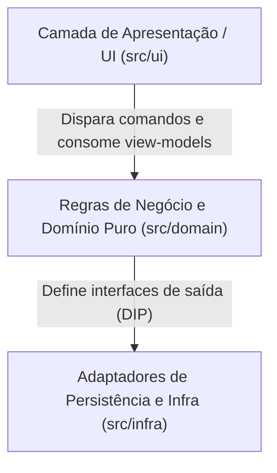

<!-- COMMON BLOCK | DO NOT MODIFY STRUCTURE OR FIELD NAMES -->
## Identification

<doc:schema_version>0.0</doc:schema_version>
<doc:file_type>spec-architecture</doc:file_type>
<doc:form_block_cardinality>single</doc:form_block_cardinality>
<doc:language>pt-BR</doc:language>

## Document State

<doc:document_status>draft</doc:document_status>

## Workflow

<doc:owner>srs-writer</doc:owner>
<doc:commissioned_by>user</doc:commissioned_by>
<doc:consumed_by>implementer</doc:consumed_by>

## Context

<doc:project>{INSERIR_NOME_DO_PROJETO}</doc:project>
<doc:purpose>{INSERIR_OBJETIVO_TECNICO_EM_UMA_FRASE}</doc:purpose>
<doc:summary>{INSERIR_SUMARIO_EXECUTIVO_DO_ESCOPO}</doc:summary>

## References

<doc:related_docs>
<doc:input>user-order.md</doc:input>
<doc:ref>project-records/traceability/traceability-matrix.md</doc:ref>
<doc:ref>docs/adrs/0001-{slug}.md</doc:ref>
<doc:output>src/</doc:output>
</doc:related_docs>

## Provenance

<doc:created_by>srs-writer</doc:created_by>
<doc:created_at>{INSERIR_TIMESTAMP_ISO8601_UTC}</doc:created_at>

<!-- FORM BLOCK | MACHINE PARSING LAYER -->
## spec-architecture

<spec-architecture:completed_chapters>1,2</spec-architecture:completed_chapters>
<spec-architecture:component_count>0</spec-architecture:component_count>
<spec-architecture:api_endpoint_count>0</spec-architecture:api_endpoint_count>
<spec-architecture:migration_count>0</spec-architecture:migration_count>

<!-- DETAIL BLOCK | HUMAN & AGENT EXPLANATION LAYER -->
# ANMS — Especificação de Arquitetura e Requisitos de Software

***

## Capítulo 1. Fundamentos e Notação (Topo Estável)

### 1.1 Contexto e Autoridade Humana (ISO/IEC 42001 e 38507)

A definição das necessidades de negócio, regras do domínio, prioridades e critérios de aceitação final pertence exclusivamente ao usuário humano. Os agentes de IA atuam unicamente como formuladores técnicos e executores operacionais, sendo estritamente proibida a tomada de decisão autônoma de produto ou alteração de regras sem autorização registrada.
{Descrever o estado atual do domínio operacional, histórico e justificar a necessidade da criação do software}.

### 1.2 Problemas

- **Gargalo / Dor 1:** {Descrever o problema operacional específico observado no cenário atual}.
- **Gargalo / Dor 2:** {Descrever inconsistências manuais, perdas de dados ou latência enfrentadas pelo usuário}.

### 1.3 Objetivos

- **Objetivo de Negócio 1:** {Definir o estado final desejado de forma clara e observável}.
- **Critério de Sucesso Mensurável:** {Definir a métrica de impacto, ex.: 100% de conformidade com regras ou redução de tempo}.

### 1.4 Abordagem

- **Paradigma Arquitetural:** {Definir direção técnica, ex.: PWA offline-first, Clean Architecture, SPA leve}.
- **Princípios da Stack:** {Descrever escolhas de tecnologia fundamentadas em simplicidade e portabilidade}.

### 1.5 Escopo

| Dimensão | O que o sistema FAZ (In-Scope) | O que o sistema NÃO FAZ (Out-of-Scope) |
| :--- | :--- | :--- |
| **Funcionalidade Principal** | {Descrever a entrega central do software} | {Declarar explicitamente limites negativos} |
| **Integração / Dados** | {Persistência local / formatos suportados} | {Exclusão explícita de integrações não autorizadas} |
| **Usuários / Perfis** | {Público-alvo e papéis suportados} | {Perfis ou recursos fora da versão atual} |

#### 1.6 Restrições

- **Restrição de Hardware / Ambiente:** {Limites de memória RAM, CPU, armazenamento local ou contêiner}.
- **Restrição Legal e Governança:** {Conformidade estrita com ISO/IEC 42001, LGPD, licenças de código aberto e auditoria}.

#### 1.7 Limitações

- **Débito Técnico / Concessão 1:** {Concessão deliberada aceita na versão atual com respectiva justificativa}.
- **Compromisso de Escala:** {Limitações conhecidas de concorrência ou volume de dados para esta iteração}.

#### 1.8 Glossário do Projeto

| Termo | Definição Canônica | Termos Rejeitados / Sinônimos Proibidos |
| :--- | :--- | :--- |
| **{Termo 1}** | {Definição técnica precisa alinhada ao domínio} | {Termos coloquiais ou ambíguos a evitar} |
| **{Termo 2}** | {Definição técnica precisa alinhada ao domínio} | {Termos coloquiais ou ambíguos a evitar} |

#### 1.9 Notação Normativa

As palavras-chave **SHALL**, **SHALL NOT**, **REQUIRED**, **SHOULD**, **SHOULD NOT** e **MAY** neste documento devem ser interpretadas conforme a RFC 2119 e RFC 8174. O termo **SHALL** é formalmente equivalente à formulação mandatória da sintaxe EARS.

***

### Capítulo 2. Requisitos de Software (Sintaxe EARS)

#### 2.1 Requisitos Funcionais

*Os requisitos funcionais devem adotar identificadores estáveis e seguir rigorosamente um dos 5 padrões da sintaxe EARS com a palavra-chave mandatória SHALL:*

- **[REQ-{DOMINIO}-001 | Ubíquo]:** O sistema SHALL {ação contínua ou propriedade permanente fundamental do sistema}.
- **[REQ-{DOMINIO}-002 | Event-Driven]:** Quando {evento gatilho ocorrer}, o sistema SHALL {resposta operacional esperada}.
- **[REQ-{DOMINIO}-003 | State-Driven]:** Enquanto {sistema estiver no estado específico}, o sistema SHALL {comportamento contínuo mantido}.
- **[REQ-{DOMINIO}-004 | Unwanted Behavior]:** Se {condição de falha ou anomalia ocorrer}, então o sistema SHALL {resposta defensiva e segura}.
- **[REQ-{DOMINIO}-005 | Opcional]:** Onde {funcionalidade opcional estiver ativada}, o sistema SHALL {ação correspondente}.

#### 2.2 Requisitos Não Funcionais (NFRs)

*Os NFRs devem prescrever grandezas numéricas verificáveis nas dimensões de qualidade:*

- **[REQ-NFR-001 | Ubíquo]:** O sistema SHALL responder às ações de cálculo e renderização com latência P95 inferior a {ex: 200 ms} em carga nominal.
- **[REQ-NFR-002 | Ubíquo]:** O sistema SHALL manter 100% das funcionalidades operacionais ativas sem conexão de rede através de persistência local.
- **[REQ-NFR-003 | Ubíquo]:** O sistema SHALL sanitizar todas as entradas de dados e criptografar registros em repouso no armazenamento local.
- **[REQ-NFR-004 | Ubíquo]:** A interface com o usuário SHALL atender compulsoriamente aos critérios de conformidade da diretriz WCAG 2.1 nível AA.

***

### Capítulo 3. Arquitetura Lógica e Componentes (Base Flexível)

#### 3.1 Diagrama Estrutural (Mermaid)



#### 3.2 Componentes e Responsabilidades

| Componente | Diretório no Repositório | Responsabilidade Única (SRP) | Requisitos Atendidos |
| :--- | :--- | :--- | :--- |
| **{Módulo Domínio}** | `src/domain/{modulo}` | {Encapsular regras de negócio puras e cálculos} | `REQ-{DOM}-001`, `REQ-{DOM}-002` |
| **{Módulo Interface}** | `src/ui/{modulo}` | {Renderizar telas, capturar entradas e emitir eventos} | `REQ-{DOM}-003` |
| **{Módulo Adaptador}** | `src/infra/{modulo}` | {Persistência local no IndexedDB/SQLite e periféricos} | `REQ-{DOM}-004`, `REQ-NFR-002` |

#### 3.3 Contratos e Interfaces de Dados

- **Interfaces Públicas:** {Especificar assinaturas TypeScript, esquemas JSON Schema ou contratos DTO}.
- **Tratamento de Exceções:** {Definir catálogo de tipos de erro retornados pelas camadas de serviço}.

#### 3.4 Decisões Arquiteturais Integradas (ADRs em Y-Statement)

- **ADR-0001:** No contexto de {Contexto C}, diante de {Decisão D}, decidimos por {Opção O}, para alcançar {Benefício B}, aceitando {Trade-off T}. *(Detalhes em `docs/adrs/0001-{slug}.md`)*.

***

### Capítulo 4. Especificação de Comportamento (BDD / Gherkin)

#### 4.1 Cenários (Gherkin)

*Blocos estruturados com a sintaxe Gherkin para servirem como oráculos computáveis nos testes de integração e CI/CD. Cada cenário deve conter o rastreamento explícito para o requisito correspondente:*

```gherkin
Funcionalidade: {Nome da Funcionalidade Principal}
  Como {Papel do Usuário}
  Quero {Ação do Sistema}
  Para que {Benefício de Negócio}

  Contexto:
    Dado {estado inicial ou pré-condição compartilhada}

  Cenário: SC-001 {Nome do Cenário Crítico de Sucesso}
    (traces: REQ-{DOMINIO}-002)
    Dado {estado ou pré-condição inicial}
    Quando {ação disparada}
    Então {resultado mensurável esperado}
    E {efeito colateral ou persistência confirmada}

  Cenário: SC-002 {Nome do Cenário de Comportamento Indesejado / Falha}
    (traces: REQ-{DOMINIO}-004)
    Dado {estado do sistema}
    Quando {tentativa de ação inválida ou falha}
    Então {o sistema deve rejeitar a operação com erro padronizado}
    Mas {nenhum estado intermediário inconsistente deve ser gravado}
```

- **Status de Validação:** PENDENTE (PASS / CONDITIONAL / FAIL / SKIP)
- **Observação:** {Registros de execução ou oráculo vinculado}.

#### 4.2 Mapa de Elementos da Interface (UI)

| Rota / Tela | Componente | Evento do Usuário | Disparo de Caso de Uso |
| :--- | :--- | :--- | :--- |
| `/{rota}` | `{NomeComponente}` | `{Clique / Input}` | `{Ação no Domínio}` |

#### 4.3 Esquemas de Dados e Persistência

- **Modelo / Tabela:** {Definir chaves primárias, tipos e índices para IndexedDB, SQLite ou storage}.

#### 4.4 Tratamento Sistemático de Erros

| Código de Erro | Causa-Raiz | Mensagem Amigável ao Usuário | Ação de Recuperação |
| :--- | :--- | :--- | :--- |
| `ERR-{DOM}-001` | {Condição anômala} | {Mensagem segura e clara} | {Fallback ou reentrada} |

***

### Capítulo 5. Estratégia de Testes e Matriz de Homologação

#### 5.1 Níveis de Teste e Pirâmide de Qualidade

- **Testes de Unidade:** Foco em 100% das regras puras de domínio (`src/domain/`) com injeção de dependência e sem dependência de I/O externo.
- **Testes de Integração:** Validação dos limites de módulos, adaptadores de armazenamento e contratos de serviço.
- **Testes de Desempenho:** Validação empírica dos thresholds dos NFRs (ex.: latência P95 com k6).
- **Testes Ponta a Ponta (E2E) e UAT:** Validação direta dos fluxos críticos automatizados a partir dos cenários Gherkin do Capítulo 4.

#### 5.2 Matriz Canônica de Testes

| Nível de teste | Alvo | Política | Ferramenta / Framework | Critério de aprovação |
| :--- | :--- | :--- | :--- | :--- |
| **Unitário** | Regras de Domínio (`src/domain`) | Gerados pelo implementer para cobrir 100% da lógica pura | Vitest / Pytest | Cobertura >= 80%, Pass Rate >= 95% |
| **Integração** | Adaptadores (`src/infra`) e APIs | Testar contratos e persistência em banco local | Vitest / Pytest | 100% de aprovação (0 falhas) |
| **Desempenho** | Rotas e cálculos críticos | Testar limites de latência P95 e throughput | k6 / Benchmarks | Latência P95 < 200 ms, 0 erros |
| **E2E / UAT** | Fluxos completos do usuário | Mapear cenários Gherkin do Capítulo 4.1 | Playwright | 100% dos cenários em PASS |

#### 5.3 Oráculos e Critérios de Conclusão Técnica

- **Contrato de Saída:** A esteira de testes deve retornar obrigatoriamente `EXIT_CODE = 0` para validar o avanço no pipeline de desenvolvimento.
- **Imutabilidade de Oráculos:** Em conformidade com a norma RAT-020, é expressamente proibido alterar asserções ou oráculos para mascarar falhas de código.

***

### Capítulo 6. Conformidade com Princípios de Design

A matriz abaixo estabelece a conformidade compulsória da arquitetura e do design detalhado com os 25 princípios canônicos de engenharia de software (Quality Gate R2 / R4):

| Categoria | ID | Nome completo | Aplicação e conformidade no projeto |
| :--- | :--- | :--- | :--- |
| **Nomenclatura** | `PRIN-NAM-01` | *Intention-Revealing Naming- | Nomes de classes, variáveis e métodos comunicam intenção sem abreviações crípticas ou termos genéricos (`data`, `info`, `temp`). Alinhados ao Glossário 1.8. |
| **Dependências** | `PRIN-DEP-01` | *Dependency Direction (Clean Architecture)- | Dependências apontam unicamente de fora para dentro. O núcleo de domínio não importa UI, persistência ou bibliotecas de terceiros. |
| **Dependências** | `PRIN-DEP-02` | *Stable Dependencies Principle (SDP)- | Módulos voláteis dependem de módulos mais estáveis. O domínio puro é a camada de máxima estabilidade da aplicação. |
| **Simplicidade** | `PRIN-SIM-01` | *KISS (Keep It Simple, Stupid)- | O design adota a solução funcional mais simples, eliminando camadas redundantes ou padrões desnecessários. |
| **Simplicidade** | `PRIN-SIM-02` | *YAGNI (You Aren't Gonna Need It)- | Proibida a criação de recursos, tabelas ou abstrações especulativas para requisitos que não foram formalizados no Capítulo 2. |
| **Simplicidade** | `PRIN-SIM-03` | *DRY (Don't Repeat Yourself)- | Cada regra de negócio possui uma representação única, canônica e não ambígua no domínio. Ausência de duplicação lógica. |
| **Separação** | `PRIN-SOC-01` | *Separation of Concerns (SoC)- | Separação rigorosa entre regras de negócio, representação visual (UI) e adaptadores de armazenamento e rede. |
| **Separação** | `PRIN-SOC-02` | *Single Responsibility Principle (SRP)- | Cada classe ou módulo possui apenas uma razão para mudar e um único ator/propósito atribuído. |
| **Separação** | `PRIN-SOC-03` | *Single Level of Abstraction (SLAP)- | Funções e métodos mantêm um único nível conceitual, delegando detalhes operacionais a rotinas auxiliares. |
| **SOLID** | `PRIN-SOL-01` | *Open/Closed Principle (OCP)- | Módulos são abertos para extensão (via polimorfismo ou estratégia) e fechados para modificação direta de contratos consolidados. |
| **SOLID** | `PRIN-SOL-02` | *Liskov Substitution Principle (LSP)- | Subtipos ou implementações concretas de adaptadores substituem suas abstrações sem quebrar as propriedades do sistema. |
| **SOLID** | `PRIN-SOL-03` | *Interface Segregation Principle (ISP)- | Interfaces são granulares e específicas para cada cliente, evitando impor métodos desnecessários aos consumidores. |
| **SOLID** | `PRIN-SOL-04` | *Dependency Inversion Principle (DIP)- | Módulos de alto nível não dependem de módulos de baixo nível; ambos dependem de abstrações declaradas no domínio. |
| **Acoplamento** | `PRIN-CPL-01` | *Law of Demeter (LoD)- | Módulos interagem apenas com colaboradores diretos, vedando chamadas encadeadas profundas (*train wrecks- como `a.b.c()`). |
| **Acoplamento** | `PRIN-CPL-02` | *Command-Query Separation (CQS)- | Métodos que alteram estado não retornam dados do domínio; consultas retornam dados sem produzir efeitos colaterais. |
| **Legibilidade** | `PRIN-LEG-01` | *Principle of Least Astonishment (POLA)- | Comportamentos das funções são intuitivos e previsíveis, sem armadilhas semânticas ou surpresas ocultas. |
| **Legibilidade** | `PRIN-LEG-02` | *Programmer Intent Expression (PIE)- | O código e a estrutura expressam claramente o "porquê" das decisões, alinhando a implementação aos requisitos. |
| **Testabilidade**| `PRIN-TST-01` | *Design for Testability- | Componentes são instanciáveis com injeção de dependência e testáveis de forma determinística sem depender de rede ativa. |
| **Pureza** | `PRIN-PUR-01` | *Pure / Impure Separation- | Separação estrita entre funções puras (cálculos de regras matemáticas de domínio) e funções impuras (operações de I/O e persistência). |
| **Transições** | `PRIN-STA-01` | *State Transition Atomicity- | Transições de estado são atômicas e protegidas por validação de invariantes, impedindo estados intermediários inválidos. |
| **Transições** | `PRIN-STA-02` | *Glitch Prevention- | Prevenção de inconsistências temporárias durante atualizações em cascata na reatividade da interface. |
| **Concorrência** | `PRIN-CON-01` | *Concurrency Safety- | Prevenção ativa de deadlocks, corridas e operações assíncronas do tipo *Check-Then-Act- sem sincronização adequada. |
| **Erros** | `PRIN-ERR-01` | *Defensive Error Handling- | Erros e exceções são capturados e tratados nas bordas, vedando a supressão silenciosa (*empty catch*) de anomalias. |
| **Recursos** | `PRIN-REC-01` | *Resource Management & Immutability- | Ciclo de vida pareado de recursos (abertura/fechamento) e adoção de imutabilidade para eventos e estados persistidos. |
| **Eficiência** | `PRIN-EFF-01` | *Resource Efficiency & Budget- | Consumo de memória RAM, CPU e armazenamento dimensionados estritamente dentro do orçamento do ambiente (ex.: limites de 8 GB). |

***

<!-- FOOTER | IMMUTABLE AUDIT TRAIL -->
## Last Updated

<doc:updated_by>srs-writer</doc:updated_by>
<doc:updated_at>{INSERIR_TIMESTAMP_ISO8601_UTC}</doc:updated_at>

## Change Log

<doc:change_log>
<entry at="{INSERIR_TIMESTAMP_ISO8601_UTC}" by="srs-writer" action="criacao inicial do template ANMS (capitulos 1 e 2)" />
<entry at="{INSERIR_TIMESTAMP_ISO8601_UTC}" by="architect" action="atualizacao v2: harmonizacao das 9 secoes do Cap 1, NFRs e matriz de 25 principios do Cap 6" />
</doc:change_log>
